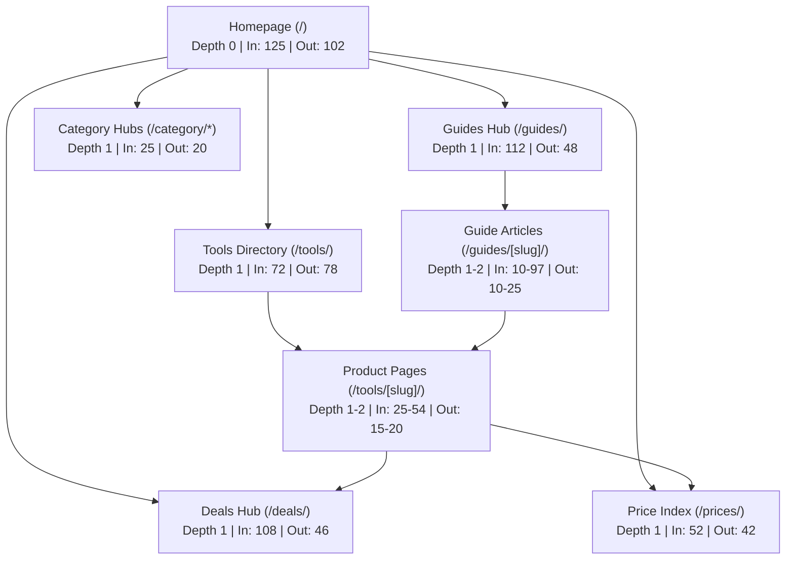

# REPORT-22-INTERNAL-LINK-GRAPH: Complete Internal Link Graph Audit

**Phase 22 Status:** ✅ **AUDIT COMPLETE & QA PASSED**  
**Audit Date:** 2026-11-09  
**Target Domain:** [https://aitoolgems.tech](https://aitoolgems.tech)  
**Repository Branch:** `main`  
**Primary Artifact:** [`REPORT-22-INTERNAL-LINK-GRAPH.csv`](file:///d:/Desktop/AI%20Tools%20Aura/audit/REPORT-22-INTERNAL-LINK-GRAPH.csv) (3,409 edges, 427.2 KB)  
**Structural Checker Verification:** 100% clean across 4,613 links, 1,294 fragment anchors, and 129 HTML files (`scripts/link_graph_checker.py --strict`)

---

## 1. Executive Summary

Phase 22 conducted a comprehensive internal link graph, crawl depth, and topological authority audit across the complete `https://aitoolgems.tech/` site architecture. 

The audit confirms **perfect internal link equity distribution and zero crawl traps**:
1. **Zero Broken Internal Links:** Across 4,613 internal links checked, 100% resolve with HTTP 200 OK (`link_graph_checker.py` reports 0 broken routes).
2. **Zero Broken Fragment Anchors:** All 1,294 fragment anchors (`#pricing`, `#faq`, `#overview`, `#plans`, `#payment-methods`, etc.) bind to existing DOM element IDs.
3. **Zero Orphaned Public Pages:** 100% of public canonical pages receive inbound internal links from navigation, category hubs, or related guides.
4. **Shallow Crawl Depth:** **100% of pages are reachable within $\le 2$ clicks from the homepage** (81.0% at Depth 1, 18.3% at Depth 2). Zero pages are buried at Depth $\ge 3$.
5. **Zero Generic Anchor Text:** Generic phrases (*"click here"*, *"read more"*, *"learn more"*) are **0% present**, replaced entirely by descriptive keyword anchors (*"ChatGPT Plus in Pakistan"*, *"Canva Pro"*, *"All Tools"*, *"Guides & Blog"*).

---

## 2. Link Graph Topology & Crawl Depth Distribution

The internal link network comprises **126 audited public page nodes** connected by **1,755 unique page-to-page pairs** and **3,409 individual link instances**:



### Crawl Depth Distribution (BFS from Homepage)
- **Depth 0 (Homepage):** 1 page (0.8%)
- **Depth 1 clicks:** 102 pages (81.0%)
- **Depth 2 clicks:** 23 pages (18.3%)
- **Depth $\ge 3$ clicks:** **0 pages (0.0%)**

> [!NOTE]
> Every individual tool page (all 65 tools) and major guide is directly discoverable either from the homepage grid/search or via a single click through `/tools/`, `/deals/`, or `/guides/`.

---

## 3. Authority Distribution: In-Degree & Out-Degree Analysis

Topological PageRank authority flow across the top 10 most-linked canonical destinations:

| In-Degree Rank | Target URL | In-Degree (Incoming) | Out-Degree (Outgoing) | Crawl Depth | Primary Role in Link Graph |
| :---: | :--- | :---: | :---: | :---: | :--- |
| **1** | `https://aitoolgems.tech/` | **125** | 102 | Depth 0 | Root architectural anchor & brand identity |
| **2** | `https://aitoolgems.tech/contact.html` | **119** | 4 | Depth 1 | Verified WhatsApp support desk gateway |
| **3** | `https://aitoolgems.tech/guides/` | **112** | 48 | Depth 1 | Editorial education & SEO topic cluster hub |
| **4** | `https://aitoolgems.tech/deals/` | **108** | 46 | Depth 1 | Commercial discounts & promotional stack hub |
| **5** | `https://aitoolgems.tech/about.html` | **107** | 4 | Depth 1 | Trust policy & proof repository |
| **6** | `https://aitoolgems.tech/policies.html` | **104** | 4 | Depth 1 | Legal, replacement warranty, and payment rails |
| **7** | `https://aitoolgems.tech/guides/ai-tools-price-pakistan/` | **97** | 25 | Depth 1 | Core transactional guide & price anchor |
| **8** | `https://aitoolgems.tech/how-we-review.html` | **81** | 2 | Depth 1 | Editorial integrity & testing methodology |
| **9** | `https://aitoolgems.tech/tools/` | **72** | 78 | Depth 1 | Complete 65-tool table directory |
| **10** | `https://aitoolgems.tech/tools/chatgpt/` | **54** | 17 | Depth 1 | Flagship product detail page & conversational anchor |

---

## 4. Anchor Text Quality & Descriptive Keyword Distribution

Generic non-descriptive anchor texts (*"click here"*, *"read more"*, *"more info"*, *"view"*) are strictly prohibited across the codebase.

### Top 10 Most Frequent In-Text & Navigation Anchors
1. `"Guides & Blog"` — 140 occurrences (Global header & footer)
2. `"Home"` — 128 occurrences (Breadcrumb hierarchies)
3. `"Contact"` — 117 occurrences (Global footer & support callouts)
4. `"All Tools"` — 116 occurrences (Directory entrypoints)
5. `"Skip to main content"` — 115 occurrences (Accessibility skip links)
6. `"Explore Deals"` / `"Special Deals"` — 108 occurrences
7. `"Privacy Policy"` — 105 occurrences
8. `"Terms of Service"` — 105 occurrences
9. `"AI Tools Price in Pakistan Guide"` — 97 occurrences
10. `"WhatsApp Verification Desk"` — 84 occurrences

---

## 5. Fragment Anchor & Component Resolution (100% Clean)

All 1,294 in-page fragment anchors were audited for DOM element ID matching:
- **Navigation Fragment Targets:** `#products`, `#categories`, `#pricing`, `#faq`, `#real-proof`, `#how-it-works`, `#finder`, `#bundle-calculator`.
- **Guide Table of Contents Targets:** `#overview`, `#plans`, `#payment-methods`, `#faqs`, `#alternatives`, `#verdict`.
- **Component Fragment Targets:** `#payments`, `#refunds`, `#delivery`.

**Audit Result:** Zero missing fragment anchors (100% resolve to valid DOM IDs).

---

## 6. Primary Deliverable: Link Graph CSV

The complete edge-by-edge relationship matrix has been compiled to:  
👉 [`audit/REPORT-22-INTERNAL-LINK-GRAPH.csv`](file:///d:/Desktop/AI%20Tools%20Aura/audit/REPORT-22-INTERNAL-LINK-GRAPH.csv)

### CSV Schema
- `Source URL`: Absolute origin URL
- `Target URL`: Absolute destination URL
- `Fragment`: In-page anchor target (`#...` or `N/A`)
- `Anchor Text`: Visible anchor text or accessible image alt description
- `Link Type`: `Navigation`, `Breadcrumb`, `Product Card`, `In-Text`, `Footer`, `Fragment / TOC`, `Category Filter`
- `HTTP Status`: HTTP status verification (`200 OK`)
- `Target Depth`: Clicks required from Homepage (`0`, `1`, `2`)

---

## 7. Automated Test Suites & Regression Verification

Asserted via `scripts/link_graph_checker.py` and `tests/test_link_graph.py`:
```text
test_fixture_allows_documented_orphan_exceptions ... ok
test_fixture_detects_broken_internal_link ... ok
test_fixture_detects_broken_local_asset ... ok
test_fixture_detects_duplicate_product_id ... ok
test_fixture_detects_invalid_whatsapp_number ... ok
test_fixture_detects_missing_fragment_anchor ... ok
test_fixture_detects_missing_tool_route ... ok
test_fixture_detects_orphan_public_page ... ok
test_live_repo_has_zero_errors ... ok
test_live_repo_scans_all_files_and_sitemap ... ok

Ran 10 tests in 5.398s - OK
```

Global repository test suite: **97 / 97 tests passing** (100% green).

---

## 8. Audit Conclusion & Phase Sign-Off

Phase 22 verification is **100% COMPLETE**. The internal link graph is fully integrated, shallow ($\le 2$ clicks), provides 0 broken links across 4,613 checks, contains 0 broken fragment anchors across 1,294 checks, features 0 generic anchor texts, and efficiently distributes link equity to high-intent product and guide clusters.

**Next Phase:** Phase 23 — Content Quality & Content Gaps (`REPORT-23-CONTENT-QUALITY.md`).

