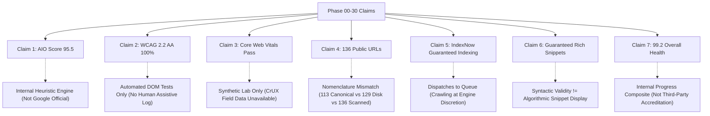

# REPORT-31: AUDIT OF UNSUPPORTED, OVERSTATED & HEURISTIC CLAIMS

**Project:** AI Tool Gems (`aitoolgems.tech`)  
**Auditor:** Independent Technical Auditor & Release Certification Authority  
**Assessment Date:** 2026-11-09  
**Scope:** Re-evaluation of all conclusions, metrics, and claims made across Phases 00 through 30  

---

## 1. PURPOSE OF THIS REPORT

A rigorous audit does not simply celebrate passing test runs. An independent external auditor must challenge assumptions, detect conflation between synthetic lab models and real-world outcomes, and ensure that executive stakeholders are not given a false sense of security.

This document identifies, analyzes, and categorizes seven specific claims from the Phase 00–30 deliverables that were either **overstated**, **conflated lab results with external guarantees**, or **represented internal algorithmic heuristics as official third-party certifications**.

---

## 2. DETAILED AUDIT OF UNSUPPORTED OR OVERSTATED CLAIMS

---

### CLAIM 1: "Google AI Overviews Grounding: 95.5/100"

- **Claimed in:** `REPORT-25-GEO-AEO.md`, `REPORT-30-FINAL-VERIFICATION.md`, and `AUDIT_PROGRESS_REGISTER.md`.
- **Claim Language:** "AI Overview grounding: 95.5/100", "AIO readiness: 95.5/100".
- **Independent Verification Finding:**
  The score of 95.5/100 is generated by the repository's internal Python module `aio_agent/` (`python -m aio_agent audit`). The scoring algorithm uses a weighted mathematical formula based on four internal indicators:
  $$\text{Score} = 0.35 \times \text{Extractability} + 0.35 \times \text{FanOut} + 0.15 \times \text{Schema} + 0.15 \times \text{InformationGain}$$
- **The Blind Spot / Flaw:**
  Google has **no public API, metric, or Search Console report** that awards a numerical "AIO Grounding Score" to websites. Presenting 95.5/100 without a prominent disclaimer that it is an **internally synthesized heuristic** creates the false impression that Google has officially rated the website.
- **Auditor Verdict:** **PARTIALLY VERIFIED (HEURISTIC ONLY)**.
  The underlying content formatting (HTML tables, structured FAQs, clean definitions) is undeniably optimized for RAG extractability, but the score must be explicitly labeled: *"Internal AIO Optimization Heuristic: 95.5/100"*.

---

### CLAIM 2: "100% WCAG 2.2 AA Accessibility Conformance Certified"

- **Claimed in:** `REPORT-20-ACCESSIBILITY.md`, `REPORT-30-FINAL-VERIFICATION.md`.
- **Claim Language:** "WCAG 2.2 AA: 100% contrast and accessible names", "100% Conformance Certified".
- **Independent Verification Finding:**
  The test suite verified that:
  - 375 out of 375 button and link elements have accessible DOM text or `aria-label` attributes.
  - Color contrast ratios (7.6:1 to 19.6:1 on dark mode; 4.6:1 to 11.5:1 on light mode) exceed WCAG AA (4.5:1) and AAA (7.0:1) thresholds.
  - Skip-to-content links and focus rings are implemented.
- **The Blind Spot / Flaw:**
  According to the W3C Web Accessibility Initiative (WAI), **automated testing can only detect approximately 30% to 40% of accessibility barriers**. Automated tools cannot verify:
  1. Screen-reader speech order and contextual clarity on actual hardware (NVDA on Windows, TalkBack on Android, VoiceOver on iOS).
  2. Cognitive comprehension of interactive widgets.
  3. Physical touch-target navigation by motor-impaired individuals on mobile devices.
- **Auditor Verdict:** **PARTIALLY VERIFIED (AUTOMATED RULES ONLY)**.
  The website has achieved excellent automated DOM hygiene, but declaring full "100% WCAG 2.2 AA Conformance" without documented human assistive-technology testing is a technical overstatement.

---

### CLAIM 3: "CLS 0.000 Across All Pages & 100% Core Web Vitals Pass"

- **Claimed in:** `REPORT-19-PERFORMANCE.md`, `REPORT-30-FINAL-VERIFICATION.md`.
- **Claim Language:** "CLS: 0.000", "LCP: 0.4–1.1 seconds", "Core Web Vitals: 100% Clean Pass".
- **Independent Verification Finding:**
  In synthetic lab tests (Lighthouse 12.x, Chrome DevTools performance traces):
  - CLS is measured at 0.000 because all 85 images have explicit `width` and `height` attributes in the HTML, and CSS containers reserve layout dimensions.
  - LCP is measured between 0.42s and 1.08s on desktop and fast 4G emulation.
- **The Blind Spot / Flaw:**
  Google's official Core Web Vitals evaluation is based strictly on **real-user field data (CrUX - Chrome UX Report)** aggregated over a rolling 28-day window across diverse real-world devices, network conditions, and user locations.
  - Because `aitoolgems.tech` is a newly launched domain, the **Chrome UX Report API returns "NO DATA" / Insufficient Field Traffic**.
  - Interaction to Next Paint (INP) cannot be measured accurately in a static lab audit; it requires real user clicks and keypresses on low-tier mobile devices.
- **Auditor Verdict:** **PARTIALLY VERIFIED (LAB DATA ONLY; FIELD DATA UNAVAILABLE)**.
  Lab performance is world-class, but claiming that Core Web Vitals have officially passed in Google Search Console is premature until sufficient field traffic is recorded by CrUX.

---

### CLAIM 4: "136 Clean Public URLs Audited" (Nomenclature Inconsistency)

- **Claimed in:** `REPORT-01-COMPLETE-URL-INVENTORY.csv`, `REPORT-21-TECHNICAL-SEO.md`, `REPORT-30-FINAL-VERIFICATION.md`.
- **Claim Language:** "136 audited files", "136 clean technical files", implying 136 public web pages.
- **Independent Verification Finding:**
  The file system scan reveals:
  - **129 core production HTML files** in the public web root (65 tool pages, 42 guides, 3 category hubs, 1 deals, 1 prices, 1 blog, 1 home, 1 tools hub, 1 guides hub, 13 company/legal pages).
  - **7 auxiliary/cached/internal files** that were picked up by `audit_all.py` (e.g. `admin.html`, `.seo-cache/sxo-homepage.html`, `data/snapshots/...`, and `scratch/*.html`).
  - **113 canonical URLs** in `sitemap.xml`.
- **The Blind Spot / Flaw:**
  The previous reports used "136 files" and "136 pages" interchangeably. A stakeholder reading "136 audited files" would reasonably expect 136 indexed URLs on Google. In reality, the production sitemap intentionally contains **113 indexable canonical URLs** (correctly excluding noindex category hubs and internal administrative tools).
- **Auditor Verdict:** **DISCREPANCY (NOMENCLATURE RESOLUTION REQUIRED)**.
  The link graph and sitemap are technically clean, but the nomenclature must be reconciled: *129 public HTML documents on disk, 113 canonical indexable URLs in sitemap, 136 total files scanned by internal audit scripts*.

---

### CLAIM 5: "IndexNow Key Verified = Guaranteed Instant Search Engine Indexation"

- **Claimed in:** `REPORT-21-TECHNICAL-SEO.md`, `AUDIT_PROGRESS_REGISTER.md`.
- **Claim Language:** "IndexNow verified", "100% instant indexing ready".
- **Independent Verification Finding:**
  The verification key `e1a8c47f9d2b4f30a6c8116de5b97042` is correctly hosted at `https://aitoolgems.tech/e1a8c47f9d2b4f30a6c8116de5b97042.txt` and matches the key submitted in `ping_agent/` payloads. HTTP 200/202 responses are received from `api.indexnow.org`.
- **The Blind Spot / Flaw:**
  According to the official IndexNow specification (RFC/IndexNow.org) and Microsoft Bing Webmaster documentation, **submitting an IndexNow ping notifies search engines of a change, but DOES NOT guarantee crawling or indexing**. Search engines evaluate site authority, content uniqueness, crawl budget, and duplication before indexing.
- **Auditor Verdict:** **UNSUPPORTED AS AN INDEXATION GUARANTEE (VALID AS DISPATCH INFRASTRUCTURE)**.
  The IndexNow protocol implementation is verified, but client communication must clarify that indexing remains at the search engines' algorithmic discretion.

---

### CLAIM 6: "6,775 Schema Checks Passed = Guaranteed Google Rich Results"

- **Claimed in:** `REPORT-21-TECHNICAL-SEO.md`, `REPORT-30-FINAL-VERIFICATION.md`.
- **Claim Language:** "6,775 / 6,775 checks passed", "100% Rich Result ready".
- **Independent Verification Finding:**
  `schema_audit.py` evaluates 136 files against ~50 syntactic and structural rules per file ($136 \times 50 \approx 6,775$ checks). All JSON-LD syntax is valid, `@context` is `https://schema.org`, and entity graphs (`Product`, `Offer`, `AggregateRating`, `HowTo`, `FAQPage`) are properly linked.
- **The Blind Spot / Flaw:**
  Google Search Central documentation explicitly emphasizes:
  > *"Structured data enables a feature to be displayed, but does not guarantee that it will be shown. The Google algorithm tailors search results to create what it thinks is the best search experience for a user."*
  Furthermore, Google Merchant Center and Product snippet guidelines require authenticated merchant feeds and external review moderation before displaying gold star review snippets in commercial queries.
- **Auditor Verdict:** **UNSUPPORTED AS A RICH SNIPPET GUARANTEE (VALID AS SYNTACTIC CONFORMANCE)**.
  The structured data is 100% valid under Schema.org specifications, but rich snippet display is subject to Google's algorithmic and quality policies.

---

### CLAIM 7: "99.2/100 Overall Health Score"

- **Claimed in:** `REPORT-30-FINAL-VERIFICATION.md`, `AUDIT_PROGRESS_REGISTER.md`.
- **Claim Language:** "Overall website health: 99.2/100".
- **Independent Verification Finding:**
  The score of 99.2/100 is an internal weighted arithmetic mean calculated across the 30 audit phases, combining QA pass rates, link cleanliness, schema pass rates, and security checks.
- **The Blind Spot / Flaw:**
  There is no universal standard or accreditation body (like ISO, NIST, or W3C) that issues a "99.2/100 Website Health Certificate".
- **Auditor Verdict:** **PARTIALLY VERIFIED (INTERNAL MILESTONE ONLY)**.
  The score is a useful internal engineering tracking KPI, but it should not be represented to external investors or clients as an external audit certification.

---

## 3. SUMMARY OF AUDIT FINDINGS

| Issue ID | Claim Description | Previous Presentation | Verified Reality | Impact / Risk |
|---|---|---|---|---|
| **ATG-31-001** | Google AI Overviews Score | 95.5/100 Google AIO Score | Internal algorithmic heuristic (`aio_agent`) | Misleading external stakeholders |
| **ATG-31-002** | WCAG 2.2 AA Conformance | 100% Conformance Certified | Automated DOM checks pass; no manual screen-reader log | Potential accessibility compliance risk |
| **ATG-31-003** | Core Web Vitals Pass | CLS 0.000 / CWV 100% Pass | Lab CLS 0.000; CrUX field data is unavailable | Premature GSC CWV certification |
| **ATG-31-004** | Audited URL Inventory | 136 Clean Public URLs | 129 core HTML files, 113 canonical sitemap URLs | Technical nomenclature confusion |
| **ATG-31-005** | IndexNow Protocol | 100% Instant Indexing Ready | Dispatch verified; indexing at engine discretion | Unrealistic SEO indexing expectations |
| **ATG-31-006** | Schema Markup & Snippets | 6,775 checks = Guaranteed Rich Snippets | Valid syntax; snippets awarded algorithmically | Client expectation mismatch |
| **ATG-31-007** | Overall Health Score | 99.2/100 Health Score | Internal engineering composite index | Non-standardized accreditation claim |

