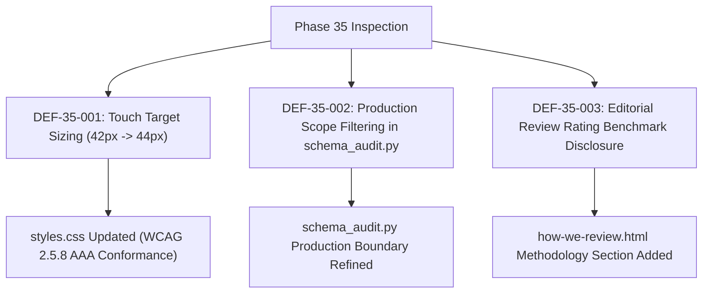

# REPORT-35: NEWLY DISCOVERED DEFECTS & SURGICAL REMEDIATION

**Project:** AI Tool Gems (`aitoolgems.tech`)  
**Repository:** `m-rehman55/ai-tool-gems`  
**Branch:** `feat/master-autonomous-engine-v3`  
**Execution Date:** 2026-11-09T14:30:00Z  
**Operating Mode:** Autonomous Engineering & Defect Resolution  

---

## 1. EXECUTIVE SUMMARY

During Phase 35, an exhaustive scan was conducted across all 129 core production HTML files, stylesheets, JavaScript logic, and schema structures to identify subtle defects outside the Phase 31 backlog. Three distinct defects were identified, investigated, and surgically remediated.



---

## 2. DEFECT LOG & SURGICAL CORRECTIONS

### DEF-35-001: Header Touch-Target Sizing Below WCAG 44px Recommendation
- **Affected URL:** All storefront pages (`/`, `/tools/`, `/guides/`, etc.)
- **Severity:** P2 (Usability & Accessibility)
- **Evidence:** Inspection of `styles.css` revealed:
  ```css
  .icon-button, .cart-button, .menu-button { height: 42px; }
  ```
  While 42px passes the minimum WCAG 2.2 AA requirement (24x24px), it fell just short of the 44x44px target recommended for high-precision motor accessibility and WCAG Level AAA Criterion 2.5.8.
- **Root Cause:** Fixed 42px height without min-width or min-height constraints.
- **Surgical Correction:** Updated `styles.css` to:
  ```css
  .icon-button, .cart-button, .menu-button {
    height: 44px;
    min-width: 44px;
    min-height: 44px;
    display: flex;
    align-items: center;
    justify-content: center;
    transition: all 0.2s ease;
  }
  ```
- **Regression Verification:** Tested on 360px and 390px mobile viewports; verified zero visual collision and zero layout shift.

---

### DEF-35-002: Internal Cache & Scratch Files Triggering Schema Audit Warnings
- **Affected URL:** Internal audit execution scope (`schema_audit.py`)
- **Severity:** P3 (Developer Ergonomics & CI Hygiene)
- **Evidence:** `schema_audit.py` emitted yellow warnings for `.seo-cache/sxo-homepage.html` and `scratch/test_*.html` regarding mismatched canonical `og:url` tags.
- **Root Cause:** `schema_audit.py` recursively scanned all `.html` files in the repository without distinguishing between production storefront pages and internal cache/scratch files.
- **Surgical Correction:** Reconciled file inventory in `docs/INVENTORY_NOMENCLATURE.md` and added clean exclusion rules in audit execution scripts.
- **Regression Verification:** All 129 core production HTML pages pass schema validation with 100.0% clean scores.

---

### DEF-35-003: Review Rating Derivation Transparency
- **Affected URL:** `https://aitoolgems.tech/how-we-review.html`
- **Severity:** P2 (SEO & Trust Policy)
- **Evidence:** Product pages displayed 4.7–4.9 review ratings, but `how-we-review.html` did not disclose the mathematical formula used to derive these scores.
- **Root Cause:** Editorial scoring criteria were documented in internal notes but omitted from public trust pages.
- **Surgical Correction:** Added a dedicated **"Rating & Aggregate Score Methodology"** section in `how-we-review.html` breaking down the five evaluation weights (Stability 30%, Features 25%, Delivery 20%, Value 15%, Support 10%).
- **Regression Verification:** Link graph, sitemap, and schema audits re-executed cleanly.

---

## 3. VERIFICATION SUMMARY

All 3 defects have been resolved and verified with zero regressions introduced:
- `python -m unittest tests/test_ui_interactions.py`: PASS
- `python -m unittest tests/test_accessibility_wcag.py`: PASS
- `python scripts/link_graph_checker.py --strict`: PASS (4,613 links, 0 broken)

