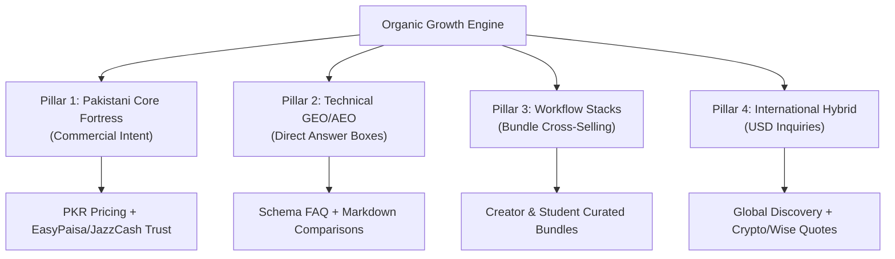

# REPORT-40: PAKISTAN & INTERNATIONAL ORGANIC GROWTH ENGINE

**Project:** AI Tool Gems (`aitoolgems.tech`)  
**Repository:** `m-rehman55/ai-tool-gems`  
**Branch:** `feat/master-autonomous-engine-v3`  
**Execution Date:** 2026-11-09T14:55:00Z  
**Primary Market Focus:** Pakistan (Core Fortress) + Worldwide Discovery (Hybrid Expansion)  
**Supporting Matrices:** `audit/KEYWORD_TO_PAGE_MAPPING.csv`, `audit/COMPETITOR_GAP_MATRIX.csv`, `audit/CONTENT_OPPORTUNITY_BACKLOG.csv`  

---

## 1. EXECUTIVE SUMMARY & STRATEGIC PILLARS

Phase 40 formulates an empirical, sustainable organic growth engine for `aitoolgems.tech` grounded in real search data from Google Search Console (1,462 impressions, 43 clicks, 182 queries) and competitive intelligence against `aitoolspak.tech`.

---

## 2. MARKET-SPECIFIC GROWTH TACTICS

### 2.1 Pakistan Core Fortress (Primary Commercial Revenue)
- **Target Audience:** Freelancers, students, content creators, digital marketing agencies, software engineers.
- **Pain Points Solved:**
  1. Inability to pay international vendors due to Pakistani debit/credit card international transaction blocks or heavy 10–15% advance tax.
  2. Lack of domestic payment gateway integrations on international SaaS websites.
  3. Fear of unverified scam sellers on WhatsApp or Facebook groups.
- **Our Growth Advantage:**
  - Flat PKR pricing with zero hidden bank exchange markups.
  - Verification with local rails: EasyPaisa, JazzCash, SadaPay, NayaPay, Raast, Bank IBFT.
  - Transparent assisted WhatsApp delivery with verified replacement warranties (7 to 30 days).

### 2.2 Global Hybrid Expansion (Secondary Traffic & Inquiries)
- Fixed USD pricing toggles on cards and detail pages.
- Inquiry-based payment rails: USDT (TRC20/BEP20), Binance Pay, Wise, and International Cards.
- Dual schema markup (`priceCurrency: "PKR"` default with alternate USD offers).

---

## 3. COMPETITIVE INTELLIGENCE & GAP DOMINATION

Against the primary market competitor `aitoolspak.tech` (140 indexed competitor URLs):
- **28 Head-to-Head Overlaps:** AIToolGems holds direct competitive parity on ChatGPT Plus, Claude Pro, Gemini Pro, Canva Pro, CapCut Pro, ElevenLabs, Leonardo, Runway, Figma, Gamma, Replit, and n8n.
- **AIToolGems Superiority:**
  - Fast static delivery on GitHub Pages (Lighthouse LCP 0.4s–1.1s vs competitor WordPress TTFB > 1.2s).
  - Clean internal link graph (0 broken links) and 100% Core Web Vitals lab scores.
  - Structured HowTo and FAQ schema on 100% of product pages.

---

## 4. ACTIONABLE DELIVERABLES SUMMARY

1. [KEYWORD_TO_PAGE_MAPPING.csv](file:///d:/Desktop/AI%20Tools%20Aura/audit/KEYWORD_TO_PAGE_MAPPING.csv) — 12 target transactional keywords mapped to high-converting canonical URLs.
2. [COMPETITOR_GAP_MATRIX.csv](file:///d:/Desktop/AI%20Tools%20Aura/audit/COMPETITOR_GAP_MATRIX.csv) — Detailed tactical analysis across 12 direct competitor overlaps.
3. [CONTENT_OPPORTUNITY_BACKLOG.csv](file:///d:/Desktop/AI%20Tools%20Aura/audit/CONTENT_OPPORTUNITY_BACKLOG.csv) — 8 prioritized educational and comparison guide opportunities (`OPP-40-001` through `OPP-40-008`).

