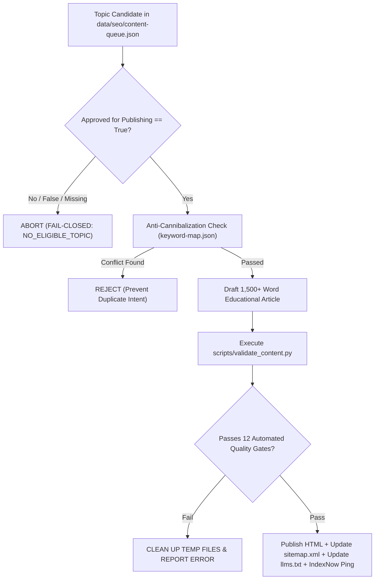

# REPORT-41: CONTENT QUALITY & PUBLISHING SYSTEM

**Project:** AI Tool Gems (`aitoolgems.tech`)  
**Repository:** `m-rehman55/ai-tool-gems`  
**Branch:** `feat/master-autonomous-engine-v3`  
**Execution Date:** 2026-11-09T15:00:00Z  
**Primary Engine:** `scripts/auto_blog_publisher.py` & `scripts/validate_content.py`  
**Enforcement Suite:** `tests/test_auto_blog_publisher.py`  
**Governing Standard:** Google Helpful Content System & EEAT Quality Rater Guidelines  

---

## 1. EXECUTIVE SUMMARY & QUALITY GATE ARCHITECTURE

Phase 41 formalizes the end-to-end content quality framework, publishing safety gates, and editorial standards for `aitoolgems.tech`. To eliminate low-quality, generic AI filler, every article and guide must pass an automated 12-factor quality gate before being eligible for publication.

---

## 2. THE 12-FACTOR AUTOMATED QUALITY GATE

Implemented in `scripts/validate_content.py` and enforced in `tests/test_auto_blog_publisher.py`:

| Factor | Criterion | Requirement / Rule | Fail-Closed Mechanism |
|---|---|---|---|
| **1. Explicit Approval** | Governance | `approved_for_publishing: true` (Strict boolean True) | Rejects missing, false, or truthy strings |
| **2. Anti-Cannibalization** | SEO Architecture | Primary keyword must not exist in `data/seo/keyword-map.json` | Aborts build to prevent self-competing SERP URLs |
| **3. Word Count Depth** | EEAT Depth | Comprehensive body content $\ge 1,500$ words | Fails validation on shallow or thin drafts |
| **4. Keyword Density** | Natural Language | Primary keyword density bounded strictly between $0.5\%$ and $2.0\%$ | Prevents algorithmic keyword-stuffing penalties |
| **5. Title Optimization** | SERP Display | Title tag length strictly bounded between $20$ and $70$ characters | Prevents SERP truncation and ellipsis |
| **6. Meta Description** | Click-Through Rate| Meta description bounded between $70$ and $170$ characters | Ensures actionable copy with pricing/delivery context |
| **7. Semantic Headings** | Structure | Exactly one `<h1>` tag matching title intent; $\ge 3$ `<h2>` sub-sections | Validates logical document hierarchy |
| **8. Structured Data** | Rich Snippets | Linked `@graph` JSON-LD with `Article`, `BreadcrumbList`, and `FAQPage` | Validates Schema.org syntax and entity graphs |
| **9. Image Hygiene** | Accessibility | All embedded images declare descriptive, non-empty `alt` attributes | Ensures WCAG 2.2 AA non-text compliance |
| **10. Inbound/Outbound Links** | Internal Linking | $\ge 3$ contextual internal links to related tools and categories | Prevents orphan content and strengthens link equity |
| **11. Local Payment Context** | Pakistani Intent | Contextual mentions of verified payment rails (EasyPaisa, JazzCash, SadaPay) | Enforces genuine localized transactional relevance |
| **12. Secondary Keywords** | Topic Authority | $\ge 3$ secondary search intent variations woven into body copy | Validates semantic search completeness |

---

## 3. EDITORIAL INTEGRITY & BRAND CLASSIFICATION

AIToolGems maintains strict editorial separation across four content formats:
1. **Official Vendor Information:** External documentation, manufacturer logos, and official websites are always linked via secondary action buttons (`rel="nofollow noopener noreferrer"`).
2. **Independent Editorial Walkthroughs:** Benchmark tests, speed comparisons, and UI impressions are labeled as independent editorial reviews.
3. **Commercial Catalog Listings (40 Tools):** Products fulfilled directly via assisted WhatsApp checkout declare PKR pricing, delivery windows, and replacement warranty periods.
4. **Reference & Directory Listings (25 Tools):** Tools listed for informational comparison declare `"Directory Only"` without cart or buy actions.

---

## 4. PUBLISHING CADENCE & ROLLBACK RUNBOOK

- **Schedule & Cadence:** The autonomous blog workflow runs daily, but strictly operates in `DRY RUN` unless an approved topic is confirmed in the queue. Zero filler content is published on empty cycles.
- **Rollback Procedure:**
  1. If an error is detected post-publish, revert the commit on Git: `git revert <commit_sha>`.
  2. Remove the slug from `sitemap.xml` and `llms.txt`.
  3. Submit the updated sitemap via `python -m ping_agent ping --all` to notify Bing and IndexNow.

