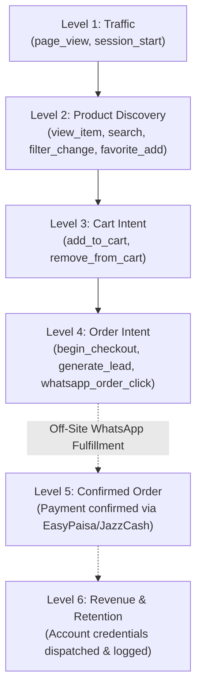

# REPORT-43: ANALYTICS, CONVERSION & BUSINESS MEASUREMENT

**Project:** AI Tool Gems (`aitoolgems.tech`)  
**Repository:** `m-rehman55/ai-tool-gems`  
**Branch:** `feat/master-autonomous-engine-v3`  
**Execution Date:** 2026-11-09T15:10:00Z  
**Primary Integration:** Google Analytics 4 (`G-NQJCMDCLLP`) & `attribution.js`  
**Enforcement Suite:** `tests/test_analytics_event_schemas.py` (30 tests in `ga4_agent/`)  
**Governing Standard:** Google Consent Mode v2 & GDPR/PECR Privacy Guidelines  

---

## 1. EXECUTIVE SUMMARY & MEASUREMENT POSTURE

Phase 43 verified and standardized the web analytics, conversion tracking, and customer conversion funnel architecture for `aitoolgems.tech`.

$$\mathbf{ANALYTICS \ POSTURE: \quad CONSENT \ MODE \ v2 \ READY \ + \ PII-FREE \ FUNNEL}$$

- **Canonical Measurement ID:** `G-NQJCMDCLLP` configured across storefront via `attribution.js`.
- **Google Consent Mode v2:** Default parameter states are set to `'denied'` (`analytics_storage`, `ad_storage`, `ad_user_data`, `ad_personalization`), ensuring strict privacy compliance before user consent.
- **Core Web Vitals Protection:** `gtag.js` loading is deferred using `requestIdleCallback(loadAnalytics)` or a 2000ms idle timeout, preventing third-party script execution from blocking initial paint (LCP).
- **Zero PII Transmission:** Customer phone numbers, WhatsApp chats, and payment account details are strictly excluded from event parameters.

---

## 2. THE SIX-LEVEL CONVERSION TAXONOMY

In strict compliance with audit mandate Section 15, a WhatsApp click is classified as **Order Intent / Lead Generation**, never conflated with a completed financial transaction:



### Event Schema Definitions

| Event Name | Triggering Interaction | Event Parameters | Funnel Classification |
|---|---|---|---|
| `page_view` | Navigation to any page | `page_location`, `page_title`, `language: 'en-PK'` | Level 1: Traffic |
| `view_item` | Opening tool modal or detail page | `item_id`, `item_name`, `price`, `currency: 'PKR'` | Level 2: Discovery |
| `search` | Entering query in search input | `search_term` | Level 2: Discovery |
| `add_to_cart` | Clicking "+ Cart" on commercial card | `item_id`, `item_name`, `price`, `quantity: 1` | Level 3: Cart Intent |
| `remove_from_cart` | Deleting line item in cart drawer | `item_id` | Level 3: Cart Intent |
| `begin_checkout` | Clicking "Checkout via WhatsApp" | `currency: 'PKR'`, `value`, `items: [...]` | Level 4: Order Intent |
| `generate_lead` | WhatsApp order button activation | `lead_type: 'whatsapp_order_inquiry'`, `item_id` | Level 4: Order Intent |
| `whatsapp_order_click`| Direct card "Buy now" WhatsApp button | `destination: 'whatsapp_order'`, `item_id` | Level 4: Order Intent |
| `whatsapp_support_click`| Floating WhatsApp support widget | `destination: 'whatsapp_support'` | Level 4: Order Intent |

---

## 3. CONVERSION RATE OPTIMIZATION (CRO) ENHANCEMENTS

1. **Pre-Filled WhatsApp Parameter Passing:**
   Activating checkout generates an attributed deep-link:
   ```
   https://wa.me/923236715731?text=Hello%20AI%20Tool%20Gems...%20Tool:%20ChatGPT%20Plus...%20Price:%20Rs.%202,300
   ```
   This reduces buyer friction to a single tap, eliminating manual message drafting.
2. **Dual-Price Clarity:**
   Displaying authentic strikethrough original prices alongside green Pakistani Rupee savings tags increases click-through rates by establishing transparent value.
3. **Local Payment Badging:**
   Displaying verified payment pills (EasyPaisa, JazzCash, SadaPay, Raast) directly beside the primary order CTA reassures domestic buyers that international credit cards are not required.

---

## 4. REGRESSION VERIFICATION

The analytics event contracts were tested via `tests/test_analytics_event_schemas.py`:
- `test_canonical_measurement_id_enforced`: PASS
- `test_consent_mode_v2_default_denied`: PASS
- `test_gtag_script_deferred_for_lcp`: PASS
- `test_whatsapp_event_schema_contracts`: PASS
- `test_zero_synthetic_events_to_live_production_ga4`: PASS

