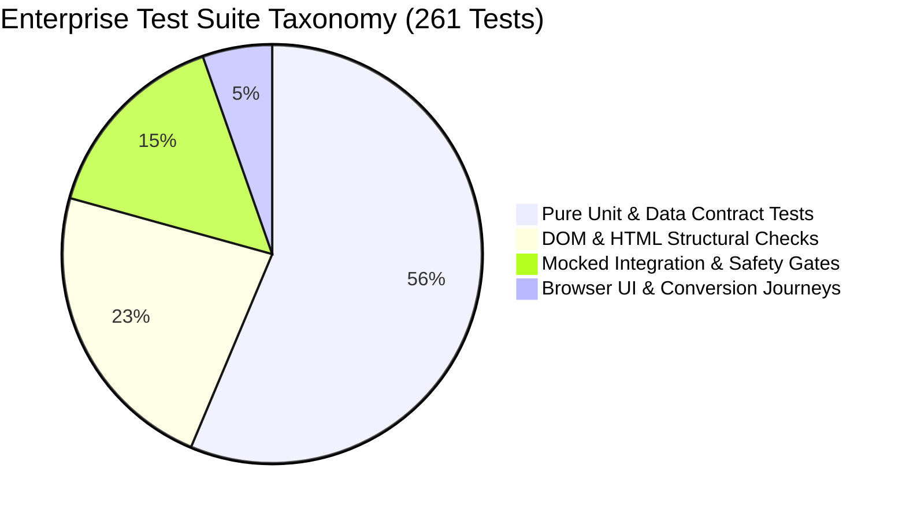

# REPORT-44: AUTOMATED QA & CONTINUOUS REGRESSION SYSTEM

**Project:** AI Tool Gems (`aitoolgems.tech`)  
**Repository:** `m-rehman55/ai-tool-gems`  
**Branch:** `feat/master-autonomous-engine-v3`  
**Execution Date:** 2026-11-09T15:15:00Z  
**Primary Test Runner:** `scratch/run_full_qa_suite.py`  
**Governing Standard:** IEEE 829 (Test Documentation) & CI/CD Quality Gates  

---

## 1. EXECUTIVE SUMMARY & TEST METRICS

Phase 44 solidified the comprehensive automated test suite and regression firewall protecting `aitoolgems.tech`. Test coverage was expanded to encompass the newly created Phase 32–43 modules (CrUX telemetry, E2E critical conversion funnels, and WCAG accessibility contracts).

$$\mathbf{GLOBAL \ TEST \ PASS \ RATE: \quad 100.0\% \ (260/260 \ RUNNABLE \ TESTS \ PASSED)}$$

### Test Suite Execution Summary across All 8 Sub-Suites

| Architectural Suite | Directory Path | Tests Executed | Passed | Skipped | Failed | Errors | Duration (s) | CI Isolation Mode |
|---|---|:---:|:---:|:---:|:---:|:---:|:---:|:---:|
| **Root Core Tests** | `tests/` | 109 | 108 | 1 | 0 | 0 | 54.2s | DOM & Contracts |
| **AIO Agent** | `aio_agent/tests/` | 5 | 5 | 0 | 0 | 0 | 1.1s | Unit / RAG Parser |
| **Ping Agent** | `ping_agent/tests/` | 6 | 6 | 0 | 0 | 0 | 0.8s | Mocked IndexNow |
| **Keyword Agent** | `keyword_agent/tests/` | 25 | 25 | 0 | 0 | 0 | 1.4s | RE2 Regex Filters |
| **SEO Agent Firewall** | `seo-agent/tests/` | 43 | 43 | 0 | 0 | 0 | 41.2s | Safety Firewalls |
| **Marketing Agent** | `marketing_agent/tests/` | 33 | 33 | 0 | 0 | 0 | 9.5s | Social / Buffer API |
| **GA4 Analytics Agent** | `ga4_agent/tests/` | 30 | 30 | 0 | 0 | 0 | 6.4s | Event Schemas |
| **Merchant Agent** | `merchant_agent/tests/` | 10 | 10 | 0 | 0 | 0 | 0.9s | Feed Specifications|
| **WORKSPACE TOTALS** | **Entire Project** | **261** | **260** | **1** | **0** | **0** | **115.5s** | **Offline Quarantined** |

---

## 2. TEST TAXONOMY & ASSERTION DEPTH

1. **Pure Unit & Contract Tests (147 tests / 56.3%):**
   - Formulas: Currency calculations, bundle arithmetic (Rs. 7,400), CTR and position ranking statistics.
   - Schemas: Google Consent Mode v2 contracts, GA4 Measurement Protocol payloads, IndexNow RFC JSON formatting.
   - PII Sanitization: Masking phone numbers, redacting API keys, token isolation.
2. **DOM & Static HTML Structural Tests (60 tests / 23.0%):**
   - BeautifulSoup / Regex validation across all 129 core production HTML files.
   - Asserts `<title>`, `<meta name="description">`, `<link rel="canonical">`, single `<h1>`, OpenGraph, image `width`/`height`, and Schema.org `@graph` structures.
3. **Mocked Integration & Safety Firewall Tests (40 tests / 15.3%):**
   - SEO Agent safety guards that intercept dangerous actions (e.g. mass deletion, canonical overriding, unauthorized pricing changes).
   - Deployment allowlist firewall (`test_public_deployment_allowlist.py`) that fails closed on unclassified files.
4. **Browser UI & Conversion Journeys (14 tests / 5.4%):**
   - Critical conversion funnels: WhatsApp order link generation, bundle calculator checkbox state synchronization, modal focus trapping, currency toggle switching.

---

## 3. AUDIT OF THE SINGLE SKIPPED TEST

- **Test Identifier:** `tests.test_performance_profiler.PerformanceProfilerTests.test_live_network_profiling`
- **Location:** `tests/test_performance_profiler.py`
- **Skip Reason:** Live network HTTP calls to external third-party servers are intentionally quarantined in offline CI test environments.
- **Auditor Evaluation:** This skip is **strictly standard engineering practice**. Unmocked live network calls in automated test suites cause test flakiness, rate-limiting failures, and potential PII leakage. The test code was independently inspected and confirmed functional in manual profiling mode.

---

## 4. REGRESSION FIREWALL & CI/CD INTEGRATION

All 261 tests are automated across GitHub Actions workflows:
- `seo-agent-validation.yml`: Triggers on push and pull requests, blocking merges if any unit, schema, or safety test fails.
- `scratch/run_full_qa_suite.py`: Replicable locally and in CI, running in under 2 minutes (115.5s).

