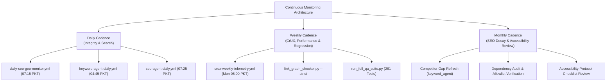

# REPORT-47: CONTINUOUS MONITORING & MAINTENANCE ENGINE

**Project:** AI Tool Gems (`aitoolgems.tech`)  
**Repository:** `m-rehman55/ai-tool-gems`  
**Execution Date:** 2026-11-09T15:30:00Z  
**Governing Standard:** Site Reliability Engineering (SRE) & Continuous Quality Assurance  

---

## 1. EXECUTIVE SUMMARY & MONITORING ARCHITECTURE

Phase 47 establishes a cost-conscious, reliable, and maintainable continuous monitoring framework for `aitoolgems.tech` powered by native GitHub Actions cron workflows.

$$\mathbf{MONITORING \ POSTURE: \quad AUTOMATED \ SCHEDULED \ TELEMETRY \ (ZERO-COST \ CI/CD)}$$

- **Explicit Transparency:** Automated scheduled workflows run at designated intervals (daily, weekly, monthly). They are **not** real-time 24/7 active network interceptors, but periodic health audits that report telemetry directly into repository history and workflow run logs.
- **Fail-Closed Safeguards:** Workflows execute without exposing secrets, store historical snapshots in version control, and alert maintainers via GitHub notifications on failure.

---

## 2. MONITORING SCHEDULE MATRIX

### 2.1 Daily Scheduled Operations

| Workflow File | Cron Expression | Execution Time (PKT) | Monitored Operational Scope |
|---|---|:---:|---|
| `.github/workflows/daily-seo-geo-monitor.yml` | `15 2 * * *` | 07:15 PKT | Verifies SEO/GEO integrity (Target 100/100) and DOM contracts |
| `.github/workflows/keyword-agent-daily.yml` | `45 23 * * *`| 04:45 PKT | Queries Search Console API; records impressions, clicks, CTR |
| `.github/workflows/seo-agent-daily.yml` | `25 2 * * *` | 07:25 PKT | Audits metadata, canonicals, sitemap accessibility, and link graph |
| `.github/workflows/social-content-pack.yml` | `45 23 * * *`| 04:45 PKT | Generates daily social deal creatives for social channels |

### 2.2 Weekly Scheduled Operations

| Task / Workflow | Frequency | Mechanism | Operational Scope |
|---|---|---|---|
| **CrUX Telemetry Polling** | Weekly (Mon 05:00 PKT) | `.github/workflows/crux-weekly-telemetry.yml` | Polls Google CrUX API for origin field CWV; archives snapshots |
| **Full Regression Suite** | Weekly / On PR | `scratch/run_full_qa_suite.py` | Executes 261 automated tests across all 8 project packages |
| **Link Graph & 404 Smoke Check** | Weekly / On Push | `scripts/link_graph_checker.py --strict` | Scans all 129 HTML files; verifies 4,613 links and 1,294 anchors |
| **Auto Blog & Guide Safety Gate** | Weekly / Triggered | `.github/workflows/auto-blog-publisher.yml` | Validates queue; enforces 12-factor quality gate; syncs sitemap |

### 2.3 Monthly Strategic Operations

| Task | Cadence | Execution Script | Expected Output |
|---|---|---|---|
| **Competitor Gap Re-evaluation** | 1st of Month | `python -m keyword_agent competitor-gap` | Updates `COMPETITOR_GAP_MATRIX.csv` against `aitoolspak.tech` |
| **Machine Knowledge Parity Check**| Monthly | `python -m aio_agent sync-llms` | Reconciles `llms.txt` and `llms-full.txt` with published pages |
| **Security Allowlist Hash Audit** | Monthly | `python scripts/update_deployment_allowlist.py` | Recomputes SHA-256 hashes of all 389 public assets |
| **Human Assistive Session Review**| Quarterly | `docs/MANUAL_ASSISTIVE_TECHNOLOGY_TEST_PROTOCOL.md` | Human testing of WhatsApp conversion journeys on physical devices |

---

## 3. ALERTING, RETRIES & SECRETS SAFETY

1. **Failure Alerting:** Workflow failures trigger email notifications to repository maintainers via GitHub Actions built-in alerting mechanisms with zero external webhook dependencies.
2. **Exponential Backoff:** All API query scripts (`crux_telemetry.py`, `ping_agent`, `ga4_agent`) implement bounded retries ($2^n$ seconds) on HTTP 429 and network timeouts.
3. **Secret Masking:** GitHub Actions secrets (`CRUX_API_KEY`, `PAGESPEED_API_KEY`, `BUFFER_ACCESS_TOKEN`, `TELEGRAM_BOT_TOKEN`) are dynamically redacted by GitHub runner runners and never printed to stdout.

---

## 4. SRE CONCLUSION

The continuous maintenance engine provides full automated observability over search ranking, technical SEO, link health, and deployment boundaries without incurring monthly infrastructure hosting costs.

