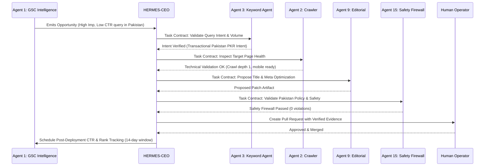

# AGENT COMMUNICATION CONTRACTS & INTER-AGENT BUS
**System**: HERMES Multi-Agent Executive Protocol  
**Schema Version**: 1.0.0  

---

## 1. Task Contract Specification

Every inter-agent request and task delegation must follow this standard JSON schema:

```json
{
  "$schema": "https://json-schema.org/draft/2020-12/schema",
  "title": "HermesTaskContract",
  "type": "object",
  "required": [
    "task_id",
    "requesting_agent",
    "responsible_agent",
    "objective",
    "scope",
    "risk_classification",
    "approval_requirement",
    "completion_criteria",
    "status",
    "created_at"
  ],
  "properties": {
    "task_id": {
      "type": "string",
      "pattern": "^TASK-[A-Z0-9]+-[0-9]{4,}$"
    },
    "requesting_agent": {
      "type": "string",
      "enum": [
        "HERMES-CEO",
        "AGENT-01-GSC",
        "AGENT-02-CRAWLER",
        "AGENT-03-KEYWORD",
        "AGENT-04-BING",
        "AGENT-05-GA4",
        "AGENT-06-POSTHOG",
        "AGENT-07-PAGESPEED",
        "AGENT-08-GEO-AEO",
        "AGENT-09-EDITORIAL",
        "AGENT-10-BACKLINK",
        "AGENT-11-COMPETITOR",
        "AGENT-12-SOCIAL",
        "AGENT-13-MERCHANT",
        "AGENT-14-CONVERSION",
        "AGENT-15-SECURITY"
      ]
    },
    "responsible_agent": {
      "type": "string"
    },
    "objective": {
      "type": "string"
    },
    "scope": {
      "type": "string"
    },
    "input_evidence": {
      "type": "object"
    },
    "required_tools": {
      "type": "array",
      "items": { "type": "string" }
    },
    "expected_output": {
      "type": "string"
    },
    "dependencies": {
      "type": "array",
      "items": { "type": "string" }
    },
    "risk_classification": {
      "type": "string",
      "enum": ["READ_ONLY", "LOW_REVERSIBLE", "MEDIUM_CODE", "HIGH_COMMERCIAL", "CRITICAL_DEPLOY"]
    },
    "approval_requirement": {
      "type": "string",
      "enum": ["AUTONOMOUS_APPROVED", "PULL_REQUEST_REQUIRED", "HUMAN_EXPLICIT_REQUIRED"]
    },
    "completion_criteria": {
      "type": "array",
      "items": { "type": "string" }
    },
    "verification_evidence": {
      "type": "object"
    },
    "created_at": {
      "type": "string",
      "format": "date-time"
    },
    "updated_at": {
      "type": "string",
      "format": "date-time"
    },
    "status": {
      "type": "string",
      "enum": [
        "NOT_STARTED",
        "IN_PROGRESS",
        "BLOCKED_PENDING_CREDENTIALS",
        "BLOCKED_PENDING_APPROVAL",
        "IMPLEMENTED",
        "TESTED",
        "VERIFIED",
        "DEPLOYED",
        "FAILED"
      ]
    }
  }
}
```

---

## 2. Risk Classification & Approval Matrix

| Risk Classification | Operations Covered | Allowed Autonomy | Mandatory Approval Gate |
| :--- | :--- | :--- | :--- |
| **READ_ONLY** | API queries, sitemap crawls, PageSpeed lab audits, keyword research, report generation | 100% Autonomous | None |
| **LOW_REVERSIBLE** | Local test runs, machine knowledge base syncing (`llms.txt`), draft generation | 100% Autonomous | Preflight validation |
| **MEDIUM_CODE** | Metadata updates, title tag improvements, schema syntax fixes, internal link enhancements | Autonomous Branch & PR | GitHub Pull Request Review & CI Suite |
| **HIGH_COMMERCIAL** | Guide publication, tool page creation, pricing adjustments, refund/terms updates | Proposed via PR | Explicit Human Owner Approval |
| **CRITICAL_DEPLOY** | Production release to `main`, DNS changes, Google Search Console URL removals | Blocked by default | Explicit Dual Confirmation & Rollback Plan |

---

## 3. Standard End-to-End Task Handoff Workflow


