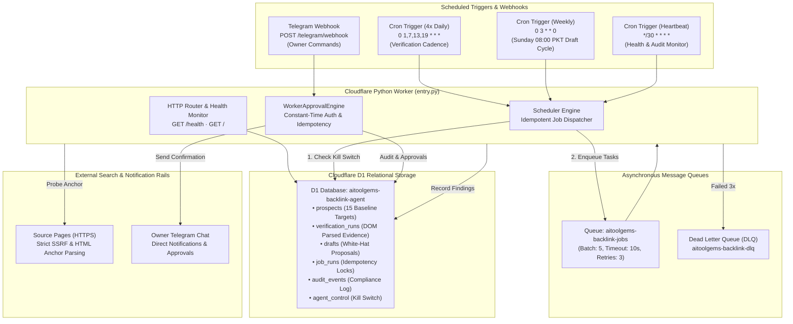

# AI Tool Gems — Backlink Agent Cloudflare 24/7 Architecture Specification

**Architecture Version:** 1.0.0  
**Target Infrastructure:** Cloudflare Workers (Python Runtime) + Cron Triggers + Queues + D1 Database  
**Author:** AI Tool Gems Autonomous Engineering Core  
**Deployment Date:** 2026-11-15  
**Operational Target:** 24/7 Serverless Laptop-Independent Execution  

---

## 1. System Overview & Design Philosophy

The AI Tool Gems Autonomous Backlink Agent is engineered as an event-driven, scheduled cloud architecture running on Cloudflare Workers. It does not rely on a brittle polling loop on a local laptop; instead, native Cloudflare platform bindings decouple job scheduling, queue processing, relational state persistence, and owner approvals.

---

## 2. Platform Bindings & Resource Mapping

| Resource | Binding Name | Purpose | Configuration Details |
|---|---|---|---|
| **Python Worker Entrypoint** | `Default` (`WorkerEntrypoint`) | Central router for HTTP, Cron triggers, and Queue batch messages. | `main: src/entry.py`, `compatibility_flags: ["python_workers"]`. |
| **D1 Database** | `DB` | Persistent relational state; stores baseline prospects, verification runs, job leases, and kill switches. | `database_name: aitoolgems-backlink-agent`, `migrations_dir: migrations`. |
| **Backlink Job Queue** | `BACKLINK_QUEUE` | Asynchronous decoupled execution for verification probes and draft generation. | `queue: aitoolgems-backlink-jobs`, `max_batch_size: 5`, `max_retries: 3`. |
| **Dead Letter Queue** | `DLQ` | Quarantines failed jobs after 3 retries for operator inspection. | `queue: aitoolgems-backlink-dlq`. |
| **Environment Secrets** | Encrypted | `TELEGRAM_BOT_TOKEN`, `TELEGRAM_OWNER_CHAT_ID`, `TELEGRAM_OWNER_USER_ID`. | Encrypted via `npx wrangler secret put`; never committed to Git. |

---

## 3. Scheduling & Cadence (Pakistan Time UTC+5)

Cloudflare Cron Triggers use UTC wall-clock time:

| Task Name | Cron Expression (UTC) | Local Time (PKT, UTC+5) | Purpose |
|---|---|---|---|
| **Verification Cycle** | `0 1,7,13,19 * * *` | 06:00, 12:00, 18:00, 00:00 | Probes candidate and live backlink pages for anchor status, rel attributes, and noindex headers. |
| **Weekly Draft & Report Cycle** | `0 3 * * 0` | Sunday 08:00 PKT | Evaluates Tier 1 prospects (score $\ge 75$), generates compliant white-hat pitches, and produces executive reports. |
| **Health & Queue Heartbeat** | `*/30 * * * *` | Every 30 minutes | Checks D1 connectivity, inspects DLQ message count, and logs heartbeat audit events. |

---

## 4. D1 Relational Schema Architecture

The database schema preserves 100% of the attributes established in the existing `offpage_authority_tracker.csv`:

1. **`prospects`:** Core directory of off-page targets. Pre-seeded with the 15 baseline prospects.
2. **`verification_runs`:** Immutable append-only log of every HTTP check. Stores DOM anchor text, rel tokens, redirect chain, and response bytes.
3. **`drafts`:** White-hat submission pitches and technical dataset citations awaiting owner review.
4. **`job_runs`:** Idempotency lock table. Uses `UNIQUE(idempotency_key)` to guarantee that no duplicate job runs concurrently or repeatedly.
5. **`audit_events`:** Tamper-evident ledger of all administrative commands, status changes, and cron runs.
6. **`agent_control`:** Dynamic kill switch and operational mode gate.

---

## 5. Security & SSRF Defense in Depth

1. **Fail-Closed Kill Switch:** Checked in D1 before every cron or queue execution. If `enabled != 'true'`, processing terminates immediately without network activity.
2. **SSRF Guard:** Rejects `http`, `ftp`, `file`, and all non-TLS schemes. Rejects embedded credentials and forbidden hostnames (`localhost`, `metadata.google.internal`, `*.internal`).
3. **Owner-Only Authentication:** Incoming Telegram webhook updates are compared against `TELEGRAM_OWNER_CHAT_ID` using constant-time string comparison (`hmac.compare_digest`). Non-private chats (groups, channels) are rejected immediately.
4. **Draft-Only Boundary:** The agent generates drafts and queues them in D1. It possesses zero capability to auto-submit web forms or blast automated outreach.

---

## 6. Monthly Cost Estimate (Cloudflare Free / Workers Paid)

Based on the projected operational volume:
- **Cron Invocations:** $4 \times 30 = 120$ verification crons + $4$ weekly crons + $1,440$ heartbeats $\approx 1,564$ invocations/month.
- **Queue Messages:** $\approx 25 \text{ verifications/day} \times 30 = 750 \text{ messages/month}$.
- **D1 Reads & Writes:** $\approx 5,000 \text{ reads/month}$, $\approx 1,500 \text{ writes/month}$.

**Cost Verdict:**
- **On Cloudflare Free Plan:** **$0.00 / month** (Within the free quota: 100,000 Worker requests/day, 5,000,000 D1 reads/month, 100,000 D1 writes/month).
- **On Workers Paid Plan ($5/mo):** Fully covered by included tier with unlimited scale.
