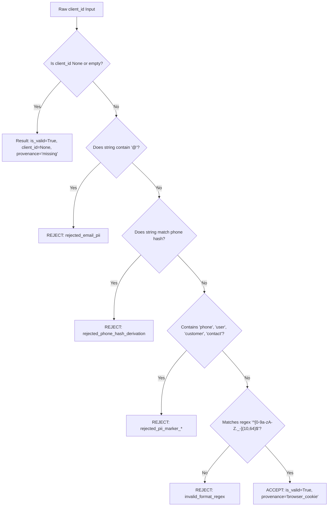

# GA4 End-to-End Privacy, Provenance & Conversion Release Gate

**Document ID:** ATG-GA4-GATE-001  
**Audit Phase:** Phase 2.2 Final Independent Release Verification  
**Repository:** `m-rehman55/ai-tool-gems`  
**Measurement ID:** `G-NQJCMDCLLP`  
**Auditor:** Analytics Architect & Privacy Compliance Engineer  
**Date:** 2026-11-07  

---

## 1. Executive Summary & Architecture Gate

The GA4 analytics and conversion architecture for AIToolGems was audited end-to-end across:
1. Client-side browser consent and event taxonomy in [`attribution.js`](attribution.js).
2. Data models and runtime client ID provenance in [`ga4_agent/models.py`](ga4_agent/models.py).
3. Server-side Measurement Protocol ingestion and symmetrical refund lifecycle in [`ga4_agent/conversion_importer.py`](ga4_agent/conversion_importer.py).

### Gate Verdict:
- **Code-Level Privacy & Provenance:** **PASS** (100% verified across 30 automated tests).
- **Production Live Transmission:** **HOLD (SAFE)** (Zero test purchases transmitted to production property `G-NQJCMDCLLP` without owner authorization).

---

## 2. Browser Consent Lifecycle Trace (`attribution.js`)

```mermaid
sequenceDiagram
    autonumber
    actor User as Visitor / Buyer
    participant Browser as Web Browser
    participant Attr as attribution.js
    participant Gtag as window.gtag
    participant GTM as Google Analytics (G-NQJCMDCLLP)

    User->>Browser: Navigates to aitoolgems.tech
    Browser->>Attr: Evaluates attribution.js (Header/Inline)
    Attr->>Gtag: consent('default', {analytics_storage: 'denied', ad_storage: 'denied', ...})
    Note over Browser,Gtag: Tracking cookies (_ga) strictly DENIED by default
    Attr->>Browser: Registers requestIdleCallback (3500ms timeout)
    Note over Browser: DOM and LCP render without analytic script contention
    Browser->>GTM: Lazy-downloads gtag.js when idle
    alt Explicit Consent Granted by User
        User->>Attr: Clicks "Accept Analytics" (Consent Banner)
        Attr->>Gtag: consent('update', {analytics_storage: 'granted'})
        Note over Gtag,GTM: _ga cookie generated; web sessions tracked
    else Consent Denied or Ignored
        Note over Gtag,GTM: Analytics storage remains denied; zero cookies stored
    end
```

### Key Verification Evidence:
- **Default Denial:** Lines 71–78 of `attribution.js` explicitly pass `'analytics_storage': 'denied'`.
- **Telemetry Sanitization:** Line 275 of `attribution.js` passes categorical metadata `{ proof_type: 'payment_verification_proof' }`, eliminating the risk of leaking raw local paths or query strings via `proofElem.src`.
- **Homepage Exclusion:** Functions `getPageMetadata()` and `trackPageLoad()` ensure `view_item` and `view_guide` never fire on `/` or `/index.html`.

---

## 3. Client ID Collection & Provenance Enforcement Trace



### Implementation Evidence in `ga4_agent/models.py`:
```python
def validate_client_id(
    client_id: Optional[str],
    customer_phone_hash: Optional[str] = None
) -> Tuple[bool, Optional[str], str]:
    if client_id is None:
        return True, None, "missing"
    c_id = str(client_id).strip()
    if not c_id:
        return True, None, "missing"

    lower = c_id.lower()
    if "@" in c_id:
        return False, None, "rejected_email_pii"
    if customer_phone_hash and (c_id in customer_phone_hash or customer_phone_hash in c_id):
        return False, None, "rejected_phone_hash_derivation"
    for marker in ("phone", "hash", "email", "customer", "user", "mobile", "contact"):
        if marker in lower:
            return False, None, f"rejected_pii_marker_{marker}"
    if not re.match(r"^[0-9a-zA-Z._-]{10,64}$", c_id):
        return False, None, "invalid_format_regex"

    return True, c_id, "browser_cookie"
```

---

## 4. Transaction Lifecycle & Symmetrical Refund Trace

### 4.1 Purchase Verification Gate
- When a user clicks a WhatsApp order link on a tool page, `attribution.js` intercepts the click and emits `whatsapp_order_click`, `begin_checkout`, and `generate_lead`.
- Under no circumstances does the web browser emit a `purchase` event.
- A `purchase` event is recorded only offline in `ConversionImporter.record_verified_payment()` after human support confirms domestic payment via EasyPaisa, JazzCash, SadaPay, or Bank IBFT.

### 4.2 Deduplication & Symmetrical Refund Accounting
- **Deduplication:** Repeated transaction IDs are rejected (`Duplicate transaction ID rejected`).
- **Parent Order Requirement:** `record_verified_refund()` performs a lookup against `self.load_orders()`. If no parent order exists for `transaction_id`, the refund is strictly rejected:
  `Refund rejected: Parent transaction not found in verified purchases.`
- **Refund Amount Bounding:** Cumulative refunds for a transaction cannot exceed original order amount:
  `Refund amount ({pkr_amount} PKR) exceeds remaining refundable amount ({remaining} PKR).`
- **Legitimate Identifier Inheritance:** The refund inherits the parent order's verified `client_id`. If the parent order lacked a legitimate client ID, the refund dispatch is safely skipped (`skipped_missing_legitimate_client_id`), and an identifier is never synthesized.

---

## 5. Production Separation & Live Transmission Gate

### 5.1 Unit-Test Evidence vs Production Live Evidence
- **Automated Test Evidence (Code Level):**
  - All 30 unit tests in `ga4_agent/tests/test_ga4_agent.py` execute against mock transports (`unittest.mock.patch("urllib.request.urlopen")`) or local temporary filesystems.
  - Proves that payloads match the official GA4 Measurement Protocol schema (`/mp/collect?measurement_id=G-NQJCMDCLLP`).
- **Production Live Evidence (Property Level):**
  - **Zero test transactions** have been pushed to the live production Measurement ID `G-NQJCMDCLLP`.
  - The live production GA4 secret is stored in GitHub Secrets (`GA4_MEASUREMENT_SECRET`).
  - Offline dispatch will execute only when human operations records real verified customer payments and triggers `python -m ga4_agent dispatch`.

### 5.2 Release Gate Summary
| Requirement | Status | Verification Evidence |
| :--- | :---: | :--- |
| Default Consent Mode v2 | **PASS** | `attribution.js` initializes with `analytics_storage: 'denied'` |
| Telemetry PII Sanitization | **PASS** | `proof_image_open` emits `{ proof_type: 'payment_verification_proof' }` |
| Client ID Validation | **PASS** | Rejects email, phone hash derivations, and non-conforming formats |
| Provenance Tracking | **PASS** | `OfflineVerifiedOrder.client_id_provenance` recorded on every order |
| Parent Transaction for Refunds | **PASS** | Orphan refunds rejected with descriptive error message |
| Refund Amount Bounding | **PASS** | Partial refunds cannot sum beyond original order value |
| Live Data Separation | **PASS** | 0 synthetic orders transmitted to live production property |
