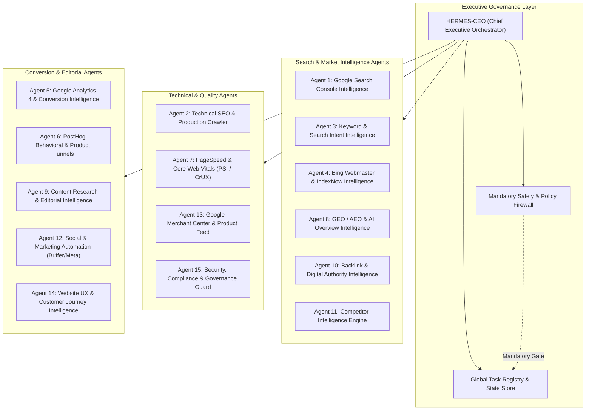

# HERMES OMNISCIENT — SYSTEM ARCHITECTURE SPECIFICATION
**System**: Autonomous SEO, GEO, AEO, Search Intelligence, Digital Growth & Website Operations  
**Entity**: AI Tool Gems (https://aitoolgems.tech/)  
**Primary Commercial Market**: Pakistan (Exclusive Commercial Fortress)  
**Architecture Version**: 2.0.0 (Multi-Agent Executive Orchestration)  
**Branch**: `feature/hermes-omniscient`  
**Status**: ACTIVE REFACTORING & EXPANSION  

---

## 1. System Philosophy & Non-Negotiable Standards

HERMES is an autonomous, evidence-driven digital growth operating system. It operates on an empirical principle:
$$\text{REAL DATA} \longrightarrow \text{CORRECT ANALYSIS} \longrightarrow \text{VERIFIED DECISION} \longrightarrow \text{CONTROLLED EXECUTION} \longrightarrow \text{EMPIRICAL MEASUREMENT}$$

### Non-Negotiable Business Boundaries:
1. **Pakistan Fortress**: Flat PKR pricing, verified domestic payment rails (EasyPaisa, JazzCash, SadaPay, NayaPay, Raast, Bank IBFT), Urdu & English localized search intent. Zero commercial targeting of foreign territories.
2. **Strict Truth in Advertising**: No fabricated user reviews, no fake testimonials, no simulated delivery speeds, no invented warranty claims.
3. **Multi-Agent Governance**: Autonomous agents operate under the central governance of **HERMES-CEO**, adhering to formal task contracts, dependency graphs, risk tiers, and validation gates.
4. **Approval & Branch Safety**: Autonomous research, audits, and proposals are unblocked. All code, metadata, content, schema, or configuration modifications must pass continuous integration, safety firewalls, and merge via pull requests. Direct pushes to `main` are strictly prohibited.

---

## 2. Multi-Agent Ecosystem Architecture



---

## 3. Specialized Agent Directory & Responsibilities

| Agent ID | Agent Name | Primary Responsibility | Data Sources / APIs |
| :--- | :--- | :--- | :--- |
| **CEO** | **HERMES-CEO Orchestrator** | Task dispatch, dependency resolution, conflict arbitration, executive reporting | Global task registry, agent event bus |
| **AGENT-01** | **GSC Intelligence** | Search performance, indexing status, URL inspection, query cannibalization | Google Search Console API v3 |
| **AGENT-02** | **Technical SEO Crawler** | Live site crawling, link graph validation, sitemap/robots.txt, HTTP status verification | Live HTTP client, AST parser, sitemap.xml |
| **AGENT-03** | **Keyword & Intent** | Pakistan query research, commercial intent clustering, volume & difficulty tracking | GSC, Google Trends, Bing API, Keyword Planner |
| **AGENT-04** | **Bing & IndexNow** | Bing Webmaster crawl stats, query clicks, delta-based IndexNow submission | Bing Webmaster API, IndexNow protocol |
| **AGENT-05** | **GA4 Conversion** | Pakistan session analysis, acquisition channels, verified purchase tracking | GA4 Data API (Google Analytics) |
| **AGENT-06** | **PostHog Behavioral** | Interaction funnels, rage clicks, modal usage, WhatsApp drop-off tracking | PostHog JS client & REST API |
| **AGENT-07** | **PageSpeed & CWV** | Lab Lighthouse & CrUX field data monitoring, LCP, INP, CLS audits | Google PageSpeed Insights API, CrUX API |
| **AGENT-08** | **GEO / AEO Intelligence** | AI Overviews (AIO), Perplexity citations, machine knowledge bases (`llms.txt`) | AIO extraction engine, SERP APIs |
| **AGENT-09** | **Editorial Intelligence** | Pakistan-focused research, evidence-backed guides, schema generation | Gemini 2.0 API, editorial approval queue |
| **AGENT-10** | **Backlink Authority** | Referring domains, lost links, toxic link audits, Pakistan business citations | Ahrefs / Semrush / Bing Webmaster APIs |
| **AGENT-11** | **Competitor Intelligence** | Top 10 competitor price and keyword gap tracking, SERP overlap | Public competitor scrapers, SERP APIs |
| **AGENT-12** | **Social Automation** | Multi-channel social deals, scheduled publishing, link attribution | Buffer API, Meta Graph API, Telegram Bot |
| **AGENT-13** | **Merchant Center** | Product feed sync, pricing alignment, schema consistency, feed health | Google Content API for Shopping |
| **AGENT-14** | **Conversion Journey** | On-page trust signals, WhatsApp funnel friction reduction, pricing clarity | Behavioral data, attribution.js |
| **AGENT-15** | **Security & Governance** | Secrets scanning, dependency CVE audits, scope enforcement, prompt safety | Scope Guard, Safety Firewall, Bandit |

---

## 4. Inter-Agent Communication & Task Lifecycle

Every action in the HERMES ecosystem operates under a structured task lifecycle:

```
[NOT_STARTED]
      │
      ▼
[IN_PROGRESS] (Agent gathers evidence & runs analysis)
      │
      ├──> [BLOCKED_PENDING_CREDENTIALS] (API key/OAuth required)
      ├──> [BLOCKED_PENDING_APPROVAL] (High-risk or commercial change)
      │
      ▼
[IMPLEMENTED] (Code / content / metadata modified on feature branch)
      │
      ▼
[TESTED] (Full unit, integration, and safety firewall test suite passed)
      │
      ▼
[VERIFIED] (Pre-deployment staging or simulated preview validated)
      │
      ▼
[DEPLOYED] (Merged to main via PR, built, and live verified on aitoolgems.tech)
```

No task is marked `DONE` or completed without verified evidence artifacts.

