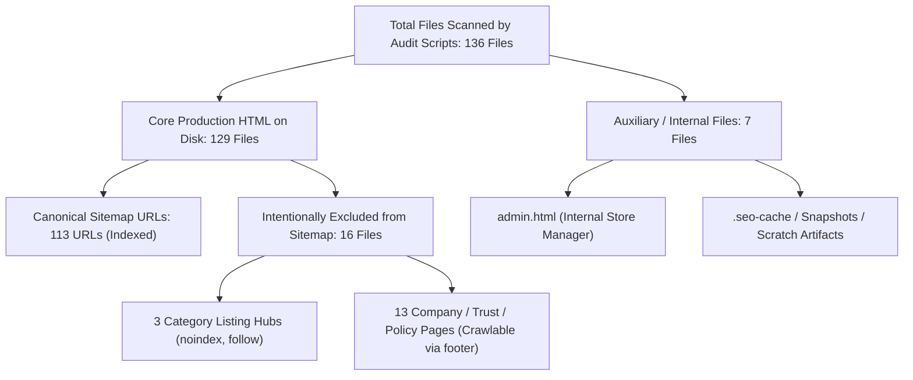

# INVENTORY & URL NOMENCLATURE SPECIFICATION

**Project:** AI Tool Gems (`aitoolgems.tech`)  
**Standard:** Enterprise Technical SEO & Site Architecture  
**Governing Issue:** ATG-31-004  

---

## 1. PURPOSE

To prevent ambiguity among developers, QA engineers, auditors, and external stakeholders, this document establishes standard terminology and exact reconciliation across three previously conflated metrics:
1. **Core Production HTML Documents on Disk (129 files)**
2. **Indexed Canonical URLs in Sitemap (113 URLs)**
3. **Artifacts Scanned by Internal Audit Scripts (136 files)**

---

## 2. RECONCILED INVENTORY TAXONOMY

---

## 3. EXACT STRUCTURAL BREAKDOWN

### 3.1 The 129 Core Production HTML Documents
These are the primary HTML files residing in the web root and public directories:
- **65 Product Tool Pages:** `tools/*/index.html` (40 assisted commercial offerings + 25 reference/directory tools).
- **42 Guide Articles:** `guides/*/index.html` (Technical walkthroughs, API integration guides, prompt engineering).
- **3 Category Listing Hubs:** `category/ai-writing/index.html`, `category/ai-design/index.html`, `category/ai-productivity/index.html`. *(Marked `noindex, follow` to prevent thin pagination cannibalization)*.
- **1 Tools Directory Hub:** `tools/index.html` (Main searchable catalog).
- **1 Guides Directory Hub:** `guides/index.html` (Index of all guides).
- **1 Live Deals Hub:** `deals/index.html` (Active discount matrix).
- **1 Price Comparison Hub:** `prices/index.html` (Comparison index).
- **1 Knowledge Blog Hub:** `blog/index.html`.
- **1 Homepage:** `index.html`.
- **13 Trust, Legal & Operational Pages:**
  - `about.html`
  - `contact.html`
  - `policies.html`
  - `privacy.html`
  - `terms.html`
  - `how-we-review.html`
  - `how-we-price.html`
  - `how-we-source.html`
  - `product-verification.html`
  - `corrections.html`
  - `faq.html`
  - `affiliate-disclosure.html`
  - `404.html`
- **Total:** $65 + 42 + 3 + 1 + 1 + 1 + 1 + 1 + 1 + 13 = \mathbf{129 \ HTML \ Documents}$.

---

### 3.2 The 113 Canonical URLs in `sitemap.xml`
The production `sitemap.xml` deliberately submits only indexable canonical destinations to optimize Google and Bing crawl budgets:
- 65 Tool Pages
- 42 Guide Pages
- 1 Homepage (`/`)
- 1 Tools Hub (`/tools/`)
- 1 Guides Hub (`/guides/`)
- 1 Deals Hub (`/deals/`)
- 1 Prices Hub (`/prices/`)
- 1 Blog Hub (`/blog/`)
- **Total:** $65 + 42 + 1 + 1 + 1 + 1 + 1 + 1 = \mathbf{113 \ Canonical \ URLs}$.

*Why the 16 remaining production files are omitted from sitemap.xml:*
- Category pages are marked `noindex, follow` by deliberate architectural design.
- Utility and error pages (`404.html`) must never be submitted in a sitemap.
- Trust and policy pages are linked in the global footer navigation and discovered naturally by crawlers.

---

### 3.3 The 136 Scanned Files
The audit scripts `audit_all.py` and `schema_audit.py` recursively traverse the repository to ensure no unvalidated HTML files exist. In addition to the 129 core production HTML files, they inspect 7 internal or cached templates:
- `admin.html`
- `.seo-cache/sxo-homepage.html`
- `data/snapshots/.../index.html`
- Internal scratch analysis templates
- **Total Scanned:** $129 + 7 = \mathbf{136 \ Files}$.

---

## 4. STANDARD USAGE GUIDELINE

Whenever citing inventory metrics:
- Refer to **"129 Production HTML Pages"** when discussing frontend site structure.
- Refer to **"113 Canonical URLs"** when discussing sitemap and search engine indexation.
- Refer to **"136 Files Scanned"** only within technical audit code execution scopes.
