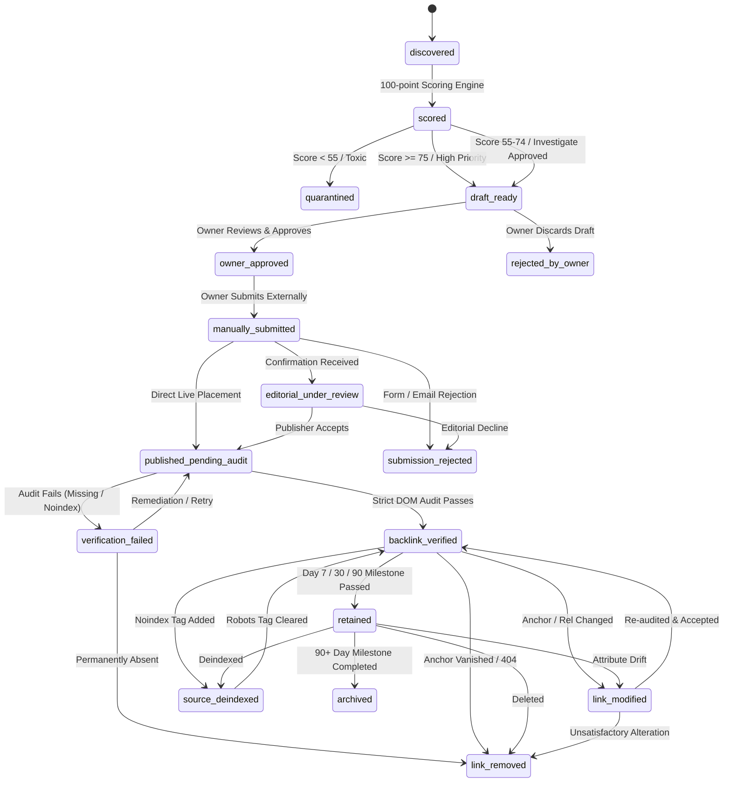

# WP15: Comprehensive Backlink Acquisition Lifecycle Specification

**Document Version:** 1.0.0  
**Status:** Approved & Implemented  
**Package:** `backlink_agent.lifecycle`  
**Governing Standard:** HERMES Autonomous SEO Operating System  

---

## 1. Executive Overview & Core Invariant

The fundamental principle governing the AI Tool Gems Backlink Acquisition Engine is:
> **"A prospect discovered is NOT a backlink. A candidate scored is NOT a backlink. A draft approved is NOT a backlink. A form submitted is NOT a backlink. ONLY an independently crawled, indexable, live DOM anchor is an earned backlink."**

Prior systems blurred the lines between opportunity intake and earned authority. WP15 introduces an immutable, stateful 17-state lifecycle machine that tracks every candidate from initial ingestion through scoring, editorial drafting, owner review, manual submission, independent crawling, and long-term retention.

---

## 2. The 17 Canonical Lifecycle States

| State | Category | Description |
| :--- | :--- | :--- |
| `discovered` | Pipeline Intake | Ingested via discovery sources (competitors, directories, roundups, broken links). |
| `scored` | Pipeline Intake | Evaluated through the 100-point 5-dimension scoring engine. |
| `quarantined` | Terminal / Rejection | Discarded due to score < 55, toxic signals, spam patterns, or paywall gates. |
| `draft_ready` | Proposal Phase | Structured pitch/listing generated with adversarial `verified_facts.yml` validation. |
| `owner_approved` | Proposal Phase | Reviewed and explicitly approved by site owner for manual submission. |
| `rejected_by_owner` | Terminal / Rejection | Rejected by site owner during manual review. |
| `manually_submitted` | Outreach & Review | Submitted by the human owner via external web form or email. |
| `editorial_under_review` | Outreach & Review | In external editorial or moderation queue awaiting approval. |
| `submission_rejected` | Terminal / Rejection | Rejected by external site editor or submission bounced. |
| `published_pending_audit` | Verification Phase | Publication announced or detected; awaiting deep DOM anchor audit. |
| `backlink_verified` | Verified Earned | Live anchor confirmed via strict DOM parsing, HTTP 200, and indexable robots. |
| `verification_failed` | Verification Phase | Deep crawl failed: anchor missing, wrong target, or blocked by noindex. |
| `retained` | Long-Term Health | Link verified at active retention checkpoints (Day 7, 30, 90). |
| `link_modified` | Long-Term Health | Anchor text, rel tokens, or target URL altered by external publisher. |
| `link_removed` | Long-Term Health | Anchor missing or page returns 404/410 during retention audit. |
| `source_deindexed` | Long-Term Health | Source page added `noindex` or `none` meta/header tags. |
| `archived` | Long-Term Health | Permanently retired or aged-out campaign record. |

---

## 3. Lifecycle Transition Graph & Invariants

### Transition Invariants
1. **Zero Auto-Submissions:** Transition from `owner_approved` to `manually_submitted` requires verified human execution evidence.
2. **Strict Evidence Requirement:** Transitions to `manually_submitted` must supply a valid `ManualSubmissionEvidence` record containing:
   - `prospect_id` matching target.
   - `submission_url` validated against SSRF protection.
   - `submission_notes` documenting date, category, and reference ID.
   - Zero credentials, passwords, or session tokens (`validate_no_secrets` guard).
3. **Verification Evidence Gate:** Transitions to `backlink_verified` must supply an independent `DetailedVerificationResult` showing `is_live_backlink=True`, HTTP 200, anchor presence, and indexability.
4. **Draft Hash Immutability:** Any state transition relying on draft approval re-validates the draft content hash (`recompute_draft_hash`) to ensure zero tampering occurred while queued.

---

## 4. SQLite Persistence & Concurrency

The local lifecycle engine (`LocalSQLiteLifecycleStore`) guarantees high-performance, race-condition-free operation:
- **WAL Mode (`PRAGMA journal_mode = WAL`):** Concurrent readers do not block writes.
- **Busy Timeout (`PRAGMA busy_timeout = 5000`):** Automatic backoff and retry during concurrent transactions.
- **Append-Only Transition Log (`lifecycle_transitions` table):** Every state change records transition timestamp, actor, previous state, new state, reason, and cryptographic payload hash.
- **Evidence Storage (`manual_submission_evidence` table):** Immutable store for submission receipts and publisher confirmation records.
