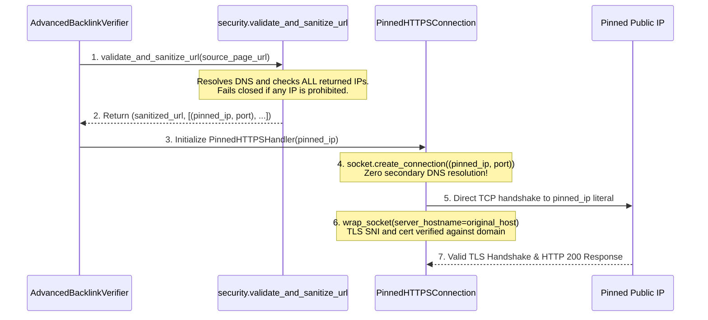

# WP16.1: DNS Rebinding and Socket-Level IP Pinning Security Closure

**Document Version:** 1.0.0  
**Phase:** Phase 2 (DNS Rebinding and SSRF Closure)  
**Verification Date:** 2026-11-15  
**Governing Module:** `backlink_agent.advanced_verifier.verifier`, `backlink_agent.security`  

---

## 1. Vulnerability Analysis: The DNS Rebinding Attack Vector

In standard Python HTTP networking, DNS resolution and TCP socket establishment occur sequentially:
1. An application resolves a hostname `rebinding.attacker.com` via `socket.getaddrinfo()`.
2. The pre-flight check validates that the returned IP is a public address (e.g. `93.184.216.34`).
3. The HTTP client (`urllib.request.urlopen`) is called with `https://rebinding.attacker.com/`.
4. The underlying HTTP client performs a *second* DNS lookup to establish the TCP connection.
5. If the attacker's authoritative nameserver returned a TTL of 0 and serves a private IP (`127.0.0.1` or `169.254.169.254`) on the second lookup, the socket connects directly to the internal resource, bypassing the pre-flight check.

---

## 2. Implemented Defense: Socket-Level IP Pinning (`PinnedHTTPSConnection`)

HERMES neutralizes DNS rebinding by tying pre-flight validation directly to the actual socket connection:

### 2.1 Technical Guarantees
1. **Connection-Time Address Pinning:** `socket.create_connection((self.pinned_ip, self.port))` connects directly to the IP literal string returned from pre-flight validation. Because it is an IP literal, the operating system never executes a secondary DNS query.
2. **TLS SNI and Certificate Verification Preserved:** `self.context.wrap_socket(self.sock, server_hostname=server_hostname)` sends the original domain name in TLS SNI and validates the remote SSL certificate against the domain name. If the certificate is invalid or untrusted, TLS verification fails closed.
3. **Multi-Answer Fail-Closed Rule:** If a hostname returns multiple IP addresses and *any* of them falls into a prohibited subnet (loopback, private RFC 1918, CGNAT, link-local, AWS/GCP metadata, IPv6 ULA/mapped), resolution fails closed immediately with `SSRFSecurityError`.
4. **Per-Hop Redirect Re-Pinning:** Every intermediate 3xx redirect location header is intercepted via `NoRedirect`, re-sanitized through `validate_and_sanitize_url`, and its new verified public IP is re-pinned for the subsequent connection.

---

## 3. Adversarial Test Evidence

The implementation is verified by adversarial unit tests in `backlink_agent/tests/test_wp16_1_security_closure.py`:
- `test_dns_rebinding_socket_pinning_connects_only_to_pinned_ip`: Confirms `PinnedHTTPSConnection` enforces connection to `pinned_ip` literal.
- `test_dns_rebinding_prohibited_ip_in_multi_answer_fails_closed`: Injects a mock DNS resolver returning both public IP (`93.184.216.34`) and loopback (`127.0.0.1`); verifies that resolution fails closed with `SSRFSecurityError`.
