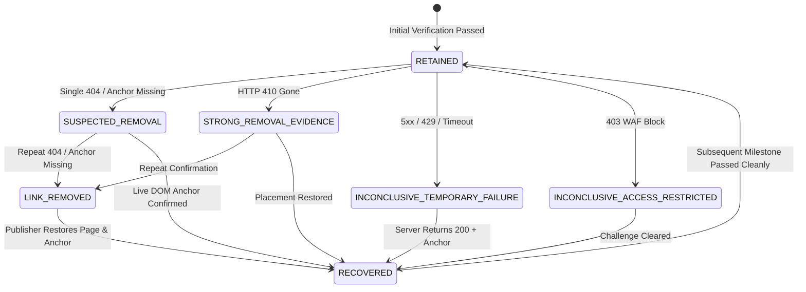

# WP16.1: Multi-Stage Retention Removal Confirmation Policy

**Document Version:** 1.0.0  
**Phase:** Phase 4 (Retention Removal Confirmation)  
**Verification Date:** 2026-11-15  
**Governing Module:** `backlink_agent.retention.monitor`, `backlink_agent.retention.models`  

---

## 1. Executive Summary & Problem Formulation

In automated backlink tracking, treating a single HTTP 404 or transient failure as an immediate, irreversible deletion creates high rates of false link-loss alarms. Websites frequently experience temporary routing misconfigurations, deployment delays, CDN cache purges, and transient WAF challenges.

WP16.1 introduces a multi-stage evidence policy that requires **repeat confirmation** before moving an earned backlink into a confirmed `LINK_REMOVED` state, while fully supporting **automatic recovery** if the placement reappears.

---

## 2. Granular Retention Response Classifications

| Server Response / DOM Signal | Initial Classification | Repeat Audit (Consecutive) | Placement Status Impact |
| :--- | :--- | :--- | :--- |
| **HTTP 404 / Missing Anchor** | `suspected_removal` | `link_removed` | Recheck scheduled; prior verified status preserved on first occurrence. Confirmed removed only on repeat. |
| **HTTP 410 Gone** | `strong_removal_evidence` | `link_removed` | High confidence removal; repeat confirmation required for final `link_removed`. |
| **HTTP 403 Forbidden / WAF** | `inconclusive_access_restricted`| `inconclusive_access_restricted`| Bot challenge / WAF block; does NOT indicate link deletion. Preserves verified status. |
| **HTTP 429 Too Many Requests** | `inconclusive_temporary_failure`| `inconclusive_temporary_failure`| Rate limiting; temporary failure. Preserves verified status. |
| **HTTP 500 - 504 Server Error** | `inconclusive_temporary_failure`| `inconclusive_temporary_failure`| Server downtime / restart. Preserves verified status. |
| **Socket Timeout / Network Err** | `inconclusive_temporary_failure`| `inconclusive_temporary_failure`| Transient network glitch. Preserves verified status. |
| **Clean DOM Audit (After Failure)**| `recovered` | `retained` | Link restored by publisher; state transitioned to `recovered` and re-instated. |

---

## 3. Placement Recovery State Machine

### 3.1 Repeat Confirmation Rules
1. **Rule 1 (First Failure):** When a previously verified placement returns HTTP 404 or the anchor tag is not found in the DOM, the snapshot records `status_detected = SUSPECTED_REMOVAL`. Historical anchor text, target destination, and verified dates are preserved without modification.
2. **Rule 2 (Repeat Confirmation):** Only if the *subsequent* audit also encounters HTTP 404, 410, or a missing anchor is the status transitioned to `LINK_REMOVED`.
3. **Rule 3 (Recovery Support):** If an audit encounters a placement previously classified as `SUSPECTED_REMOVAL`, `STRONG_REMOVAL_EVIDENCE`, `INCONCLUSIVE_TEMPORARY_FAILURE`, or `LINK_REMOVED` where the anchor, target, and indexability are verified clean, it transitions to `RECOVERED`.

---

## 4. Adversarial Test Evidence

Verified via unit tests in `backlink_agent/tests/test_wp16_1_security_closure.py` and `test_retention_monitor.py`:
- `test_retention_repeat_confirmation_lifecycle`: Traces 404 suspected $\to$ repeat confirmed $\to$ recovery.
- `test_http_404_410_removal_confirmation`: Confirms 404 initial vs repeat and 410 initial vs repeat.
- `test_http_403_access_restricted_preserves_status`: Confirms 403 maps to `INCONCLUSIVE_ACCESS_RESTRICTED`.
- `test_http_429_rate_limit_preserves_status`: Confirms 429 maps to `INCONCLUSIVE_TEMPORARY_FAILURE`.
- `test_placement_recovery_after_degradation`: Confirms transition to `RECOVERED`.
