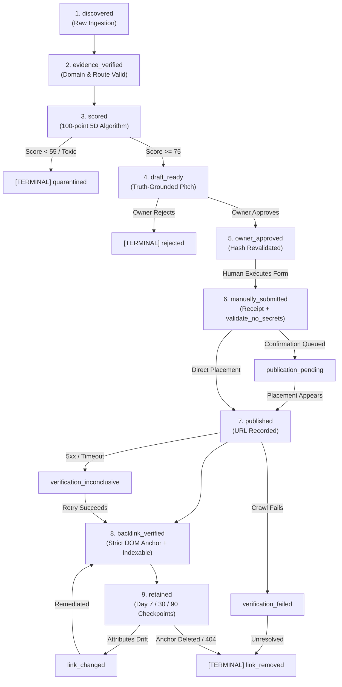

# WP16: Independent Architecture Integration Review

**Document Version:** 1.0.0  
**Phase:** Phase 1 (Independent Architecture Review)  
**Verification Date:** 2026-11-15  
**Reviewer:** Senior Staff Software Engineer & Distributed Systems Reviewer  

---

## 1. Architectural Scope & Unification Objective

The mission of Work Package 16 (WP16) is to rigorously verify that the three core autonomous backlink subsystems operate as one coherent, secure, and resilient acquisition pipeline:
1. **Intake & Proposal Layer (WP13):** Multi-channel prospect discovery, 100-point 5-dimension scoring, and adversarial `verified_facts.yml` structured drafting.
2. **Reliability & Delivery Layer (WP14):** WAL-mode SQLite outbox storage, worker lease-token fencing, crash recovery, and Telegram chunked delivery.
3. **Outcome & Retention Layer (WP15):** 17-state canonical acquisition machine, multi-hop redirect SSRF verifier, 7/30/90-day retention monitoring, and funnel conversion metrics.

---

## 2. End-to-End Prospect Lifecycle Journey

The full journey of a prospect follows a strictly enforced path where zero progress is possible without explicit evidence:

---

## 3. Core Invariant & Boundary Verification

### 3.1 Anti-Hallucination & Cardinal Invariant
- **Standard:** Discovered prospects, scored opportunities, draft listings, and owner approvals are internal pipeline stages only. **They are NEVER tallied or reported as backlinks.**
- **Enforcement:** `AcquisitionReporter` enforces `actual_active_backlinks = total_verified + total_retained`. A prospect in `discovered`, `scored`, `draft_ready`, or `owner_approved` adds `0` to active backlinks.

### 3.2 Manual Submission Evidence Gate
- **Standard:** Automated web form submission, headless browser clicking, or email outreach is strictly disabled. Submissions are human-operated only.
- **Enforcement:** Moving from `owner_approved` to `manually_submitted` requires an immutable `ManualSubmissionEvidence` record.
- **Security Guard (`validate_no_secrets`):** Inspects destination, reference URL, and submission notes. If any keyword (`password`, `secret`, `bearer`, `token`, `private_key`) is present, the transaction throws `ValueError` and fails closed.

### 3.3 Draft Hash Integrity & Replay Protection
- **Standard:** A draft approved in Telegram or CLI cannot be tampered with between proposal and submission.
- **Enforcement:** Every draft generates a SHA-256 fingerprint of its fields (`draft_type + target_asset + pitch_copy + proposed_anchor`). The state machine re-calculates and asserts `inbound_hash == stored_hash` during approval.

### 3.4 Worker Lease Fencing & Stale Crash Protection
- **Standard:** In a multi-worker or cloud runner environment, a crashed or stalled worker must never wake up after its lease expired and overwrite a newer worker's state.
- **Enforcement:** Each lease acquisition generates a cryptographically unique `lease_token` (`tok_<uuid>`). Status transitions enforce `WHERE lease_token = ?`. If a worker's lease expired and another worker claimed the task with a new token, the stale worker's commit is rejected with `0 rows updated`.
