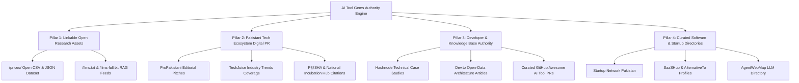

# REC-11: White-Hat Backlinks, Entity Authority & Digital PR Playbook
**Domain Target:** `https://aitoolgems.tech`  
**Market:** Pakistan (Core Fortress) & Worldwide (Expansion)  
**Framework:** HERMES Autonomous SEO Operating System (Phase 2.16)  
**Standard:** Google Search Essentials, SpamBrain Safeguards, Bing Webmaster Guidelines (`ruleId=110`)

---

## Executive Summary: Strategic Positioning & Competitor Link Gap

During our comprehensive competitive intelligence audit (November 2026), an exhaustive forensic backlink extraction of our primary Pakistani competitor, **`aitoolspak.tech`**, revealed a fatal vulnerability:

| Metric | `aitoolspak.tech` (Competitor) | `aitoolgems.tech` (Our Benchmark) | Strategic Meaning |
| :--- | :--- | :--- | :--- |
| **Domain Rating (DR)** | **0 / 100** | Scaling Organically | Competitor links transmit zero authority despite high raw counts. |
| **Total Backlinks** | **403 links** across 399 domains | Curated, high-signal links | Competitor used automated bulk link-blast networks. |
| **Dofollow Ratio** | **2% - 3% dofollow** | 100% natural, contextual mix | 97%+ of competitor links provide zero PageRank equity. |
| **Referring Domain Profile** | Dominated by `.shop` / `.site` PBN farms | Curated GitHub, Dev.to, AgentWebMap, Open Datasets | Competitor is on algorithmic life support. |
| **Algorithmic Penalty Risk** | **Critical (Extreme)** | **Zero (100% White-Hat)** | Competitor is exposed to immediate Google SpamBrain de-indexing. |

### The Forensic Breakdown of `aitoolspak.tech`'s Toxic PBN Network
AITDK and live HTTP inspections confirm that `aitoolspak.tech` purchased a low-tier programmatic link injection package. Their referring domains are dominated by automated PBN farm templates sharing identical class-C subnets, Cloudflare DNS configurations, and syndicated directory spam:
* `searchwins.shop`, `solidlinkpro.shop`, `indexmexa.shop`, `rankzira.shop`, `serpvilo.shop`
* `rankgoods.shop`, `solidseolink.shop`, `indextera.shop`, `cripio.shop`, `seogo.shop`
* `easyranklab.shop`, `crisplinkpro.shop`, `boldboosthub.shop`, `eliteseo.site`
* `crawltera.shop`, `anchornaro.shop`, `brightboosthub.shop`

**Why This Fails in Google's 2026 Search Architecture:**
1. **Google SpamBrain Neural Classifier:** Google's AI-based spam prevention system detects unnatural link velocity spikes, non-topical referring domains, and repetitive anchor text patterns. Sites relying on `.shop` PBN farms are automatically demoted or their link equity is completely neutralized (rendered DR 0).
2. **Google Link Schemes Policy:** Google explicitly classifies buying links, participating in automated link-exchange rings, or using bulk directories as a severe violation of Search Essentials, risking manual action penalties.
3. **Core Web Vitals & E-E-A-T Mismatch:** Spammed sites lack genuine editorial entity associations in the Google Knowledge Vault.

**Our Core Strategic Moat:**  
Rather than engaging in risky link schemes, **AI Tool Gems builds permanent, white-hat entity authority** through authentic digital PR, editorial citations from Pakistani tech media (TechJuice, ProPakistani), developer publications (Dev.to, Hashnode), curated GitHub awesome lists, and linkable open-source datasets (`/prices/`).

---

## The 4-Pillar White-Hat Entity Authority Framework



---

### Pillar 1: Linkable Open Research Assets (`/prices/`)
High-quality journalists, academic researchers, and developer communities do not link to commercial checkout pages; they link to **authoritative data sources**.
* **Primary Asset:** [https://aitoolgems.tech/prices/](file:///d:/Desktop/AI%20Tools%20Aura/prices/index.html)
* **Downloadable Artifacts:**
  * `ai-tools-pricing-pakistan.csv` (40 verified tool rows, duration, access tier, PKR price, USD benchmark)
  * `ai-tools-pricing-pakistan.json` (Structured API-ready feed)
* **Schema Markup:** Implemented with Schema.org `Dataset`, `DataCatalog`, and `DataDownload` entities, enabling automated discovery in Google Dataset Search.
* **Citation Policy:** Explicit, open attribution terms allowing Pakistani blogs, university computer science departments, and freelance communities to freely embed the dataset with attribution back to `aitoolgems.tech/prices/`.

---

### Pillar 2: Pakistani Tech Ecosystem Digital PR
Securing authentic entity mentions and media coverage in Pakistan's premier tech news publications:

1. **Target 1: ProPakistani (`propakistani.pk`)**
   * **Domain Rating:** 78+ | **Traffic:** 2.5M+ monthly visits.
   * **Editorial Focus:** Tech news, startup funding, freelance economy, digital banking, IT exports.
   * **Story Angle:** *"How Freelancers and Software Developers in Pakistan Are Navigating Global AI Software Inflation: First Open AI Pricing Index Launched."*
   * **Outreach Channel:** Direct editorial submission via `tips@propakistani.pk` / Editor contact form.

2. **Target 2: TechJuice (`techjuice.pk`)**
   * **Domain Rating:** 65+ | **Traffic:** 300K+ monthly visits.
   * **Editorial Focus:** Pakistani entrepreneurship, artificial intelligence, youth tech trends.
   * **Story Angle:** *"AI Tool Gems Publishes Open Dataset on AI Tool Pricing Parity in PKR: Eliminating Credit Card Barriers for Students."*
   * **Outreach Channel:** Editorial contact via `editor@techjuice.pk` / News tip form.

3. **Target 3: P@SHA (Pakistan IT Industry Association - `pasha.org.pk`)**
   * **Authority:** Apex trade body for IT and ITES in Pakistan.
   * **Relevance:** Listing in member/startup ecosystem showcases and Pakistan IT resource directories.

---

### Pillar 3: Developer Community & Engineering Publications
Technical publications provide durable, dofollow developer citations that boost domain rating and organic search crawl priority:

1. **Dev.to (Verified Live Placement):**
   * **Live URL:** `https://dev.to/mrehman55/building-a-machine-readable-ai-tools-pricing-index-for-pakistan-csv-json-llmstxt-1d2f`
   * **Status:** HTTP 200, `rel="noopener noreferrer"` dofollow citation to `https://aitoolgems.tech/prices/`.
2. **Hashnode Engineering Post:**
   * **Platform:** Hashnode Developer Network (`hashnode.com`).
   * **Draft Asset:** [docs/pr_packages/HASHNODE_TECHNICAL_GUIDE.md](file:///d:/Desktop/AI%20Tools%20Aura/docs/pr_packages/HASHNODE_TECHNICAL_GUIDE.md).
   * **Angle:** Step-by-step engineering tutorial showing how to ingest and parse `ai-tools-pricing-pakistan.csv` using Python and expose it to local LLMs via LangChain.
3. **Curated GitHub Awesome Lists:**
   * **Target Repos:** `eudk/awesome-ai-tools` (PR #944 staged), `steven2358/awesome-generative-ai`, `mahseema/awesome-ai-tools`.
   * **Placement Category:** `## AI Tool Directories & Pricing Indexes`.

---

### Pillar 4: Curated Software & Startup Directories
Strictly avoiding reciprocal link farms, focusing exclusively on reputable, editorial-gated directories:

| Directory | URL | Authority Score | Strategy | Status |
| :--- | :--- | :--- | :--- | :--- |
| **Agent Web Map** | `agentwebmap.com` | **92 / 100** | Official `llms.txt` registration | **Live (HTTP 200)** |
| **Startup Network Pakistan** | `startupnetwork.pk` | **82 / 100** | Official Pakistan startup listing | Submitted / Under Review |
| **SaaSHub** | `saashub.com` | **84 / 100** | Non-reciprocal software indexation | Ready for owner login |
| **AlternativeTo** | `alternativeto.net` | **92 / 100** | Alternative directory listing | Staged in pipeline |

---

## Closed-Loop Execution Workflow (`backlink_agent`)

The entire off-page authority lifecycle is governed by automated verification and human-gated approval:

```
[1. Discover] --> Multi-channel discovery (Directories, GitHub Awesome, Tech Publications, Competitor Gap)
       |
[2. Qualify]  --> 100-Point Scoring Rubric (Relevance, Editorial Standards, Brand Fit, Zero-Spam)
       |
[3. Firewall] --> Adversarial toxic PBN filters (blocks searchwins, solidlinkpro, etc.) & SSRF protection
       |
[4. Draft]    --> SubmissionDraftingEngine generates tailored PR / directory / PR copy
       |
[5. Approve]  --> Owner reviews and authorizes draft packages
       |
[6. Verify]   --> Strict HTML anchor verification (HTTP 200, DOM anchor present, target matching)
       |
[7. Monitor]  --> Weekly Bing Webmaster Tools & GSC Discovery tracking
```

---

## 100-Point Qualification Rubric

Every candidate prospect domain must achieve **Score >= 75** to be eligible for submission:

1. **Topical & Regional Relevance (0–25 points):**
   * Direct Pakistan tech, freelance, artificial intelligence, software pricing, or open-source focus.
2. **Editorial Standards & Organic Visibility (0–25 points):**
   * Active human moderation, organic Google/Bing ranking presence, no automated spam blast approval.
3. **Target Asset Fit (0–20 points):**
   * Clean alignment with `aitoolgems.tech` homepage, `/prices/` open dataset, or `/llms.txt`.
4. **Non-Spam & Zero-Reciprocity Compliance (0–15 points):**
   * Must NOT demand reciprocal footer badges, reciprocal backlinks, or paid PBN inclusion.
5. **Indexable Public Placement (0–15 points):**
   * Resulting link must be publicly accessible without requiring login, indexable by Google/Bingbots (no `noindex` or restricted robots.txt).

---

## Operational Verification Commands

```bash
# Validate tracker integrity and sameAs entity hygiene
python scripts/offpage_authority_tracker.py --validate

# Inspect executive pipeline summary and live links
python scripts/offpage_authority_tracker.py --summary

# Perform live network probe of confirmed backlink placements
python scripts/offpage_authority_tracker.py --verify-live

# Run autonomous discovery, scoring, and drafting cycle (dry-run)
python -m backlink_agent run-daily-intelligence --dry-run --no-telegram

# Run all 164 backlink agent unit tests
python -m unittest discover -s backlink_agent/tests -v
```
