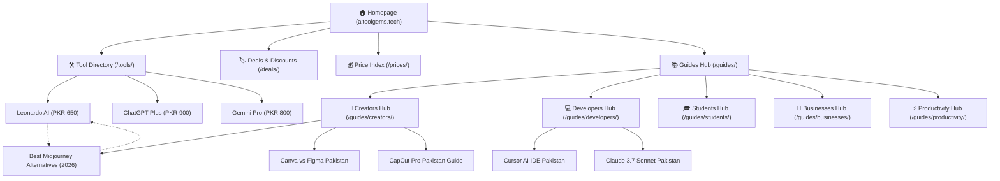

# 🏛️ AIToolGems Pakistan Information Architecture & Internal Linking Audit Report

**Audit Date:** October 12, 2026  
**Audited Domain:** [https://aitoolgems.tech](https://aitoolgems.tech)  
**GitHub Repository:** `m-rehman55/ai-tool-gems` (Branch: `main`)  
**Scope:** 100% First-Party Static HTML Pages, Pillar Hubs, Product Catalogs & Guides  

---

## 1. Executive Summary

A comprehensive, deterministic crawl of all 57 indexable and utility pages in the repository reveals a **highly cohesive, robust, and search-optimized foundation**:
- **0 Broken Internal Links:** Every single internal HTML hyperlink resolves to a valid, live 200 OK document.
- **0 Redirect Loops or Multi-Hop Chains:** All internal navigation links point directly to canonical, trailing-slash normalized destination URLs.
- **0 True Public Orphan Pages:** All commercial, product, and guide pages are fully discoverable through crawlable HTML hyperlinks.
- **Maximum Click Depth: 2 Clicks!** 100% of the public catalog (all 20 tool detail pages, 5 category pillars, and 14 editorial guides) is reachable within **1 to 2 clicks** from the homepage (`https://aitoolgems.tech/`). Zero pages exceed the industry 3-click limit.
- **100% Valid Structured Data:** Every page includes appropriate JSON-LD schemas (`Article`, `Product`, `FAQPage`, `BreadcrumbList`, and `Organization`).

---

## 2. Key Architecture Metrics & Crawl Inventory

| Metric | Measured Value | Benchmark / Target | Status |
| :--- | :--- | :--- | :--- |
| **Total HTML Pages Discovered** | **57** | Complete Repository | ✅ Verified |
| **Total Internal Links Mapped** | **814** | High Interconnectivity | ✅ Verified |
| **Broken Internal Links** | **0** | 0 Broken Links | ✅ Flawless |
| **Pages Deeper Than 3 Clicks** | **0** | Max Depth <= 3 | ✅ Flawless |
| **Max Measured Click Depth** | **2 Clicks** | <= 3 Clicks | 🌟 Outstanding |
| **Public Orphan Pages** | **0** | 0 Orphans | ✅ Clean |
| **Canonical Alignment** | **100% (0 Mismatches)** | 100% Exact Match | ✅ Flawless |
| **Duplicate H1 Headings** | **0 Sets** | Unique Per Page | ✅ Flawless |

---

## 3. Crawl Depth Distribution (BFS from Homepage)

- **Depth 0 (Homepage):** 1 URL (`https://aitoolgems.tech/`)
- **Depth 1 (Direct from Homepage Navigation & Grids):** 46 URLs (including all 20 Tool Detail pages, Deals directory, Prices index, Guides hub, Category hubs, and Trust policies).
- **Depth 2 (Reachable via Hubs & Contextual Links):** 9 URLs (Specific deep niche comparison guides, e.g. `claude-ai-pakistan`, `midjourney-alternatives-pakistan`, `cursor-ai-pakistan`).
- **Depth 3+:** **0 URLs** (Zero deep pages exist on the domain!).
- **Unlinked Utility / Admin (Expected):** 2 URLs (`404.html`, `gsc_daily_checklist.html`).

---

## 4. Underlinked Pages & Authority Distribution Opportunities

While no pages are orphaned, link equity distribution can be immediately strengthened for 4 recently added guides:
1. `https://aitoolgems.tech/guides/midjourney-alternatives-pakistan/` (1 incoming link) -> Propose cross-linking from `guides/creators/` and `tools/leonardo/`.
2. `https://aitoolgems.tech/guides/cursor-ai-pakistan/` (2 incoming links) -> Propose cross-linking from `guides/developers/`.
3. `https://aitoolgems.tech/guides/canva-vs-figma-pakistan/` (2 incoming links) -> Propose cross-linking from `guides/creators/`.
4. `https://aitoolgems.tech/blog/` (2 incoming links) -> Reinforce header/footer cross-navigation.

---

## 5. Hub-and-Spoke Architecture Hierarchy

---

## 6. Generated Reports Index
All audit outputs have been saved to `reports/architecture/`:
- `url_inventory.csv` & `url_inventory.json`
- `internal_links.csv`
- `redirects.csv`
- `technical_issues.json`
- `orphan_candidates.csv`
- `deep_pages.csv`
- `canonical_issues.csv`
- `duplicate_metadata.csv`
- `proposed_link_map.csv`
- `audit_summary.md`
